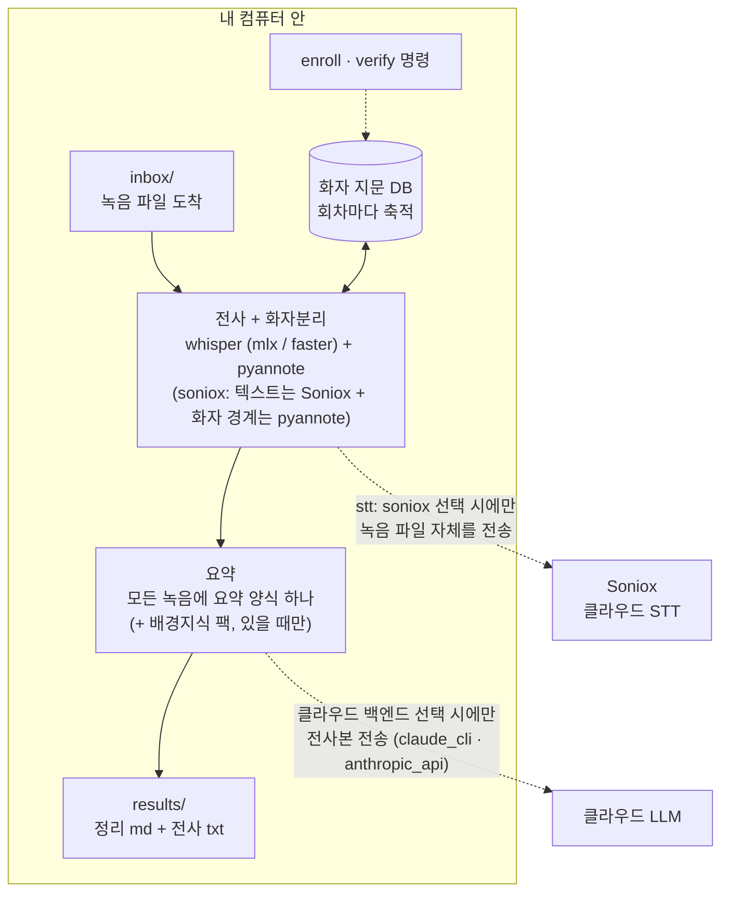

# moim-scribe

**반복해서 만나는 모임을 위한 로컬 우선 음성 파이프라인 — 같은 사람들이 자주 만날수록 더 정확해집니다.**

독서모임, 글쓰기 모임, 매주 하는 팀 회의처럼 **같은 멤버가 반복해서 만나는 자리**를 위해 만들었습니다. 지정 폴더를 감시하다가 녹음 파일이 들어오면: 전사(whisper) → 화자분리(pyannote) → **회차마다 쌓이는 음성 지문 DB와 대조해 실명 자동 매칭** → 요약까지. 어떤 종류의 녹음인지 묻지 않습니다. 회의든 통화든 독서모임이든 같은 폴더에 넣고 같은 형식으로 받습니다. 음성 지문은 항상 로컬입니다. 직접 고르는 단계가 둘 있습니다 — 전사는 기본이 내 컴퓨터이고 Soniox로 보낼 수도 있으며, 정리는 로컬(Ollama 또는 생략) 또는 클라우드 LLM(Claude)입니다.

> **동의가 먼저입니다.** moim-scribe는 참가자 전원의 동의 아래 스스로를 녹음하는 모임을 위해 만들어졌습니다. 음성 지문은 생체정보입니다 — 몰래 녹음하거나 동의 없이 사람을 식별하는 데 절대 쓰지 마세요. **사적 관계에서 특히 그렇습니다**: 연인·가족과의 대화는 한쪽이 말 없이 녹음할 유인이 가장 큰 경우이고, 그래서 가장 하지 말아야 하는 경우입니다. 많은 나라에서 이것은 무례가 아니라 불법입니다: [docs/privacy.md](docs/privacy.md)

[English README](README.md)

## 동작 구조



지문은 점선을 절대 넘지 않습니다. 넘을 수 있는 것은 둘이고 각각 직접 골라야만 넘습니다 — 녹음 파일(`stt: soniox`)과 전사본(클라우드 정리 백엔드). `soniox` + `none` 조합이면 녹음은 나가고 전사본은 안 나가며, `mlx` + `ollama`면 아무것도 안 나갑니다.

## 기능 구분

**핵심: 설치하면 바로 됩니다.**

| | 하는 일 |
|---|---|
| **화자분리** | 누가 언제 말했는지 나눕니다 (`SPEAKER_00`, `SPEAKER_01` …) |
| **음성 지문** | 누가 누군지 한 번만 확정하면, 다음 녹음부터 그 사람 이름이 자동으로 붙습니다 |
| **요약** | 모든 녹음에 요약 형식 하나. 참석자, 발화 비중, 주요 내용, 그리고 있을 때만 결정사항과 할 일 |

**선택: 직접 켜기 전에는 꺼져 있고, 핵심 기능은 이것들 없이 돌아갑니다.**

| | 더해지는 것 | 문서 |
|---|---|---|
| 클라우드 전사 | 로컬 whisper 대신 Soniox (녹음 파일을 업로드합니다) | [docs/setup-soniox.md](docs/setup-soniox.md) |
| 배경지식 팩 | 반복 모임의 참가자 명단과 이어지는 맥락을 요약 프롬프트에 추가 | [docs/packs.md](docs/packs.md) |
| 소속 태그 | 지문 매칭이 다른 모임 사람에게서 나왔을 때 로그 한 줄 | 아래 "누가 누군지 알려주기" |
| 라벨 검증 | 완성된 전사를 지문과 교차 확인 | [docs/speaker-verification.md](docs/speaker-verification.md) |
| 백그라운드 상주 | launchd / systemd / 작업 스케줄러 템플릿 | [docs/deployment.md](docs/deployment.md) |

**포함하지 않는 것.** 노션 등 외부 도구로의 발행, 메신저 알림(슬랙 등), 휴대폰에서 컴퓨터로 가져오는 접수 기능은 넣지 않았습니다. 클라우드 동기화 폴더(iCloud Drive, Google Drive, Dropbox)는 별도 연동 없이 그대로 inbox로 쓸 수 있고, 그 밖의 것은 일반 파일인 `results/` 위에 붙이면 됩니다.

## 이미 많은 whisper + pyannote 스크립트와 뭐가 다른가

일회성 화자분리 스크립트는 모든 녹음을 "처음 만난 사람들의 방"으로 취급합니다. 반복 모임은 다릅니다 — 격주마다 같은 여섯 명이잖아요. moim-scribe는 그 사실을 이용합니다.

- **축적되는 음성 지문.** 누가 누군지 한 번만 확정해주면, 그 사람의 ECAPA 임베딩이 등장할 때마다 발화초 가중 평균으로 정교해집니다. 두 번째 회차부터 `SPEAKER_03`이 자동으로 실명이 됩니다.
- **병합 복구.** 목소리가 비슷한 두 사람을 pyannote가 한 화자로 뭉쳐버리는 고전적 실패를, 등록 지문과의 세그먼트 단위 재대조로 감지하고 전사 라벨을 복구합니다. 미등록 손님의 발화는 절대 건드리지 않습니다. 라벨 복구는 앵커 전원이 그 녹음에 실제로 있었다는 세그먼트 증거를 보일 때만 적용되며, 아니면 복구를 보류하고 사유를 기록합니다(틀린 이름이 없는 이름보다 나쁘기 때문입니다).
- **두 목소리 경고.** 이름 대조가 끝나면 화자마다 긴 발화(8초 이상, 5개 이상)를 둘로 갈라 봅니다. 작은 쪽이 시간의 10% 이상이고 두 쪽의 목소리가 다르면 로그에 "two voices suspected"가 찍히고 `speakers.json`에 그 라벨이 표시됩니다. 이 검사는 라벨을 바꾸지 않습니다. 지문으로 등록하기 전에 어느 라벨을 직접 들어 봐야 하는지 알려 줄 뿐입니다. 아무와도 매칭되지 않은 1초 이하 라벨은 잡음으로 봅니다. 전사본에는 남지만 참석 인원에서 빠지고, 요약에도 그 사실이 전달됩니다.
- **환각 억제 전사.** whisper가 같은 문장을 정확히 1.0초 간격으로 17번 반복하는 류의 디코딩 병리를 디코드 옵션과 결정론적 후처리로 이중 방어합니다.
- **요약은 하나, 분류는 없음.** 어떤 종류의 녹음인지 알려줄 필요가 없습니다. 요약은 내용이 있는 절(결정사항, 할 일, 보류)만 남기고 나머지는 생략하므로, 회의는 회의록처럼 근황 대화는 근황 대화처럼 읽힙니다. 원하면 반복 모임의 참가자 명단과 배경 맥락을 프롬프트에 함께 실을 수 있습니다: [docs/packs.md](docs/packs.md)
- **정직한 라벨.** `moim-scribe verify`가 완성된 전사를 지문·참가자 명단과 교차 검증합니다. 실제 오귀속 사고에서 확립한 원칙 기반: [docs/speaker-verification.md](docs/speaker-verification.md)

## 플랫폼 지원

| | STT 백엔드 | 상태 |
|---|---|---|
| macOS (Apple Silicon) | `mlx` (mlx-whisper) | 1급 — 이 구성에서 만들어지고 실운영 검증됨 |
| Windows / Linux / Intel 맥 | `faster` (faster-whisper) | 설계상 지원, CI 유닛 검증 — 실사용 피드백 환영 |
| 모든 플랫폼 | `soniox` (클라우드) | 로컬 모델 불필요 — 대신 녹음이 업로드됩니다. 아래 참고 |

pyannote·speechbrain은 PyTorch라 어디서든 돌고(CUDA·MPS·CPU), 폴더 감시는 `watchdog`(3개 OS 네이티브 이벤트)입니다.

## 전사 백엔드

| 백엔드 | 어디서 도나 | 화자분리 | 특징 |
|---|---|---|---|
| `mlx` (Apple Silicon 기본) | 내 컴퓨터 | pyannote, 로컬 | 파일명이나 녹음 앞부분 멘트에서 인원수를 받습니다 |
| `faster` (그 외 기본) | 내 컴퓨터 | pyannote, 로컬 | 동일 |
| `soniox` | Soniox 서버 — **녹음이 업로드됩니다** | Soniox, 또는 토큰이 있으면 로컬 pyannote | 모델 다운로드 불필요. API 키 필요, 오디오 시간당 과금 |

`soniox`는 **한 명씩 순서대로 말하는 대화**에서 빠르고 정확한데, 여러 사람이 서로 말을 겹쳐 하는 시끄러운 녹음에서는 서로 다른 화자를 하나로 뭉치는 것이 실측으로 확인됐습니다. 허깅페이스 토큰이 있으면 moim-scribe가 그 약점을 보완합니다 — Soniox의 텍스트는 그대로 두고 **화자 경계만 로컬 pyannote로 다시 뽑습니다**. 기본으로 켜져 있고, 토큰이 없으면 조용히 건너뛰며, 파일명에 적은 인원수가 이 경로에서 쓰이는 유일한 방법이기도 합니다. Soniox 자체는 인원수를 받지 않습니다(화자분리가 켜고 끄는 스위치 하나이고 최대 15명까지 스스로 감지). 파일 하나당 300분 상한이 있습니다.

설정 방법과 직접 관리해야 하는 용량 상한: [docs/setup-soniox.md](docs/setup-soniox.md)

## 설치

요구사항: Python 3.11+, [ffmpeg](https://ffmpeg.org) (`brew install ffmpeg` / `winget install ffmpeg` / `apt install ffmpeg`).

```bash
# macOS Apple Silicon
pip install "moim-scribe[mlx] @ git+https://github.com/kemy-ai/moim-scribe"

# Windows / Linux / Intel 맥
pip install "moim-scribe[cross] @ git+https://github.com/kemy-ai/moim-scribe"
```

최초 1회: pyannote 화자분리 모델은 gated라서 무료 Hugging Face 토큰 발급 + 모델 약관 동의가 필요합니다. 2분이면 됩니다: [docs/setup-pyannote.md](docs/setup-pyannote.md)

## 빠른 시작

```bash
moim-scribe init ~/MyMeetings          # 워크스페이스 생성 (기본 한국어)
# HF 토큰 저장:
echo "hf_..." > ~/MyMeetings/.hf_token

moim-scribe doctor ~/MyMeetings        # ffmpeg·백엔드·토큰 점검

# inbox에 녹음 넣기 (어떤 종류의 녹음이든):
cp 녹음.m4a ~/MyMeetings/inbox/

moim-scribe watch ~/MyMeetings         # 1회만 돌리려면 scan-inbox
```

결과는 `results/`에 `YYMMDD_제목_summary.md` + 전체 전사본으로 저장됩니다. 전사본만 필요하면 `summarizer: none`으로 두세요. 추측을 없애는 팁 두 가지:

- 파일명에 인원수를 넣기 — `북클럽 5명.m4a`
- 또는 녹음 시작할 때 말하기 — "참석자 다섯 명입니다"

## 누가 누군지 가르치기

```bash
# 첫 회차 처리 후, 라벨→이름 매핑을 한 번만.
# enroll 이 읽는 것은 .jsonl 입니다(구간 start/end 가 거기에만 있음) — 그 파일은
# results/ 에 남습니다. 원본 오디오는 inbox/_done/ 으로 들어갑니다:
moim-scribe enroll inbox/_done/녹음.m4a results/YYMMDD_녹음_diarized.jsonl \
    SPEAKER_00=김하늘 SPEAKER_02=이바다 --workspace ~/MyMeetings

# 선택: 누가 어느 모임 사람인지 태그. 모임 이름은 팩 이름을 그대로 씁니다.
# --attends-all 은 모든 녹음에 나오는 사람(보통 본인)용입니다.
moim-scribe enroll … SPEAKER_00=김하늘 --group book-club --workspace ~/MyMeetings
moim-scribe enroll … SPEAKER_01=박구름 --attends-all --workspace ~/MyMeetings

moim-scribe speakers ~/MyMeetings      # 축적된 지문과 소속 확인

# 이후 회차부터 자동 식별. 완성 전사는 언제든 검증(이쪽이 읽는 것은 .txt):
moim-scribe verify inbox/_done/녹음.m4a inbox/_done/녹음_transcript_diarized.txt \
    --expected "김하늘,이바다,박구름" --workspace ~/MyMeetings
```

지문 DB를 믿을 수 있게 유지하는 규칙(사람이 확정한 구간만 등록 등)은 [docs/speaker-verification.md](docs/speaker-verification.md)에 있습니다.

`enroll`은 두 가지를 거부합니다. 잘못된 등록은 실패하지 않고, 그 뒤의 모든 녹음을 조금씩 틀리게 만들기 때문입니다.

- **한 녹음의 두 라벨에 같은 이름.** 대개 다른 실행의 라벨 번호를 옮겨 적은 경우입니다. 정말 한 사람이 두 라벨로 갈린 것이면 `--allow-duplicate`를 붙입니다.
- **그 사람의 기존 지문과 유사도 0.5 미만인 목소리.** 직접 들어 본 뒤 `--force`를 붙입니다. 0.5는 안전선이 아닙니다. 같은 사람도 전화 음질이거나 지문이 얇으면 더 낮게 나올 수 있습니다.

같은 명령의 나머지 사람은 그대로 등록되고, 하나라도 거부되면 명령은 종료 코드 1로 끝납니다.

같은 이름이 반복되어도("독서모임.m4a"가 매주) 덮어쓰지 않습니다. 두 번째는 `inbox/_done/`에 `독서모임 (2).m4a`로 보관되고, 같은 날이면 결과도 `YYMMDD_독서모임 (2)_…`로 저장됩니다. `enroll`·`verify`에는 로그에 찍힌 이름을 쓰세요.

**소속 태그는 힌트이지 규칙이 아닙니다.** 지문은 등록된 전원과 대조되므로, DB가 커질수록 다른 모임 사람이 매칭 1위가 되는 일이 생깁니다. 그럴 때 실행 로그에 "누가·어느 모임에서" 한 줄이 남고, **그 외에는 아무것도 바뀌지 않습니다.** 차단하는 설계는 실측 후 버렸습니다 — 두 번째 모임에 가입하거나 게스트로 참석하는 일이 실제로 있고, 점수 구간이 겹치며, 아무도 갱신을 기억 못 한 태그가 맞는 매칭을 조용히 미상으로 만들기 때문입니다. 태그 없는 화자·팩이 안 잡힌 녹음·`--attends-all` 표시된 사람은 검사에서 제외됩니다.

## 정리 백엔드

| 백엔드 | 필요한 것 | 전사본이 컴퓨터 밖으로 나가나? |
|---|---|---|
| `claude_cli` (기본) | Claude Code 설치 | 나감 — 기존 로그인으로 Anthropic에 전송 |
| `anthropic_api` | `ANTHROPIC_API_KEY` | 나감 — Messages API로 Anthropic에 전송 |
| `ollama` | 로컬 Ollama 실행 | 안 나감 — 이 단계에서 나가는 것 없음 |
| `none` | 없음 | 안 나감 — 화자분리 전사까지만 |

`config.yaml`에서 교체합니다. 요약 양식은 한국어·영어 둘 다 내장이고, 워크스페이스의 `packs/lenses/summary.<언어>.md`에 있습니다. 이 파일을 고치면 모든 요약의 형식이 바뀝니다. 이 표는 **전사본**에 대한 것이고, **녹음 파일**이 나가는지는 위의 `stt` 선택이 결정합니다.

## 프라이버시와 동의 — 꼭 읽어주세요

음성 지문은 **생체정보(민감 개인정보)**이고, 녹음에는 사적 대화가 담깁니다.

- **녹음과 지문 등록은 모든 참가자의 동의를 받고 하세요.** 여러 나라에서 이것은 매너가 아니라 법적 요건입니다 — 한국 개인정보보호법상 개인을 식별하는 음성 특징 정보는 민감정보(생체인식정보)로 별도의 명시적 동의가 필요합니다.
- 지문화는 항상 로컬이고, 최초 모델 다운로드 후에는 그 단계가 강제 오프라인으로 동작합니다. 네트워크에 닿을 수 있는 단계는 둘이며 직접 그렇게 설정했을 때만 그렇습니다 — `stt: soniox`는 **녹음 파일**을, 클라우드 정리 백엔드는 **전사본**을 보냅니다. 기본 설정은 녹음을 내보내지 않습니다.
- 지문(`speakers/`)·녹음·명단은 리포 밖 워크스페이스에 있고, `init`이 방어용 `.gitignore`까지 깔아줍니다. 워크스페이스를 공개 저장소에 올리지 마세요.

상세: [docs/privacy.md](docs/privacy.md)

## 백그라운드 상주

launchd(macOS)·systemd(Linux)·작업 스케줄러(Windows) 템플릿: [docs/deployment.md](docs/deployment.md). iCloud Drive·구글드라이브·Dropbox 동기화 폴더를 inbox로 쓸 수 있습니다. 처리 전에 파일이 디코딩되는지, 그리고 macOS에서는 실제로 디스크에 내려와 있거나 끝까지 읽히는지 확인합니다. 내려받는 중인 파일은 처음부터 최종 크기를 보고하고 앞부분이 재생되므로, 크기와 디코딩 검사만으로는 덜 내려온 녹음이 통과합니다.

## 유지보수

best-effort로 운영합니다: 이슈·PR은 읽지만 응답 기한은 보장하지 않습니다. 포크 환영합니다.

## 0.1에서 올리기

0.2에서 녹음 유형이 없어졌습니다. 기존 워크스페이스에서 달라지는 것:

- **폴더.** 녹음을 `inbox/meeting/`, `inbox/gathering/`, `inbox/transcript/`로 나눠 넣을 필요가 없습니다. 그 폴더들은 계속 동작하지만(`inbox/` 바로 아래 하위 폴더는 계속 훑습니다) 더는 아무 차이도 만들지 않습니다.
- **`config.yaml`의 `types:`** 는 더 이상 렌즈를 고르지 않으며, 로그에 그 사실이 한 줄 나옵니다. 한 가지는 계속 지켜집니다. `null`로 지정돼 있던 폴더(기본값은 `inbox/transcript/`)는 그 블록이 남아 있는 동안 전사 전용으로 유지되므로, 업그레이드했다고 그 전사본이 요약 백엔드로 나가기 시작하지 않습니다. 전체를 전사만 하려면 `summarizer: none`으로 두세요.
- **렌즈.** `meeting`, `gathering`, `conversation`과 `packs/styles/`가 없어졌습니다. 할 일은 없습니다. `packs/lenses/summary.<언어>.md`가 없는 워크스페이스는 내장 양식을 씁니다. 고쳐 쓰려면 패키지의 `templates/lenses/`에서 그 파일을 `packs/lenses/`로 복사해 편집하세요. `packs/lenses/`에 남은 옛 렌즈 파일은 쓰이지 않으며 그대로 둬도 됩니다.
- **팩.** `match.json`의 `"type"`과 `"style"`은 무시됩니다. 제목 키워드만으로 매칭합니다.
- **파일명.** 요약은 이제 `YYMMDD_제목_summary.md`입니다.
- **`moim-scribe process`** 에 `--type`이 필요 없습니다(넣어도 무시됩니다).

## 로드맵 (v0.2 범위 밖)

- 발행 플러그인(노션 등)·완료 알림
- `faster` 백엔드의 1급 승격을 위한 실사용 검증

## 라이선스

[MIT](LICENSE). 의존 프로젝트는 전부 공개 라이선스(whisper 구현체 MIT, pyannote.audio MIT, speechbrain·watchdog Apache-2.0)이며, gated인 pyannote **모델 가중치**는 Hugging Face에서 각자 약관에 동의하고 본인 컴퓨터로 받는 것으로 이 리포에 재배포되지 않습니다.
