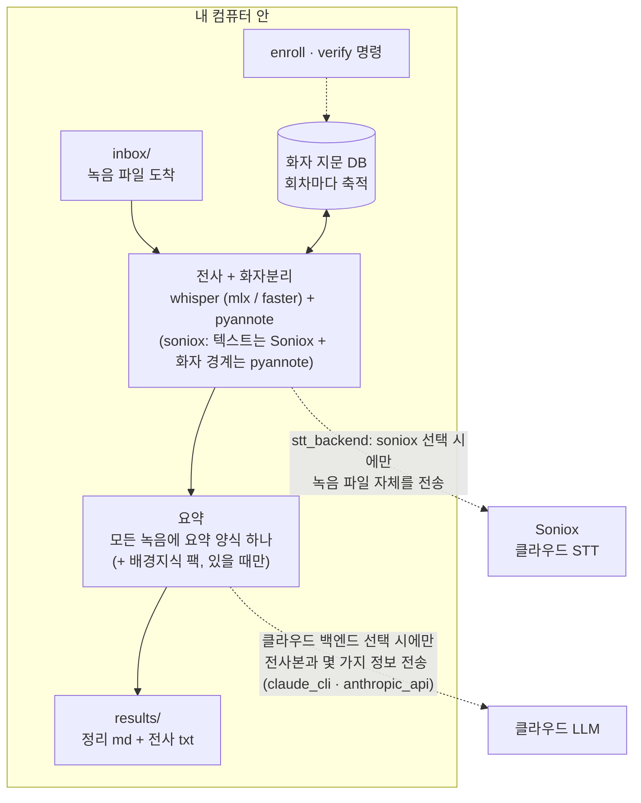

# moim-scribe

**반복해서 만나는 모임을 위한 로컬 우선 음성 파이프라인 — 같은 사람들이 자주 만날수록 더 정확해집니다.**

기본 설정에서는 요약 단계가 전사본을 Claude Code를 통해 Anthropic으로 보냅니다. `summarizer: ollama` 또는 `summarizer: none`으로 바꾸면 파이프라인은 아무것도 컴퓨터 밖으로 보내지 않습니다(작업 폴더에서 Claude Code를 여는 것은 별개의 문제입니다: "프라이버시와 동의" 참고).

독서모임, 글쓰기 모임, 매주 하는 팀 회의처럼 **같은 멤버가 반복해서 만나는 자리**를 위해 만들었습니다. 지정 폴더를 감시하다가 녹음 파일이 들어오면: 전사(whisper) → 화자분리(pyannote) → **회차마다 쌓이는 음성 지문 DB와 대조해, 확신이 있는 구간에 실명을 붙이고** → 요약까지. 어떤 종류의 녹음인지 묻지 않습니다. 회의든 통화든 독서모임이든 같은 폴더에 넣고 같은 형식으로 받습니다. 음성 지문은 항상 로컬입니다. 직접 고르는 단계가 둘 있습니다 — 전사는 기본이 내 컴퓨터이고 Soniox로 보낼 수도 있으며, 정리는 로컬(Ollama 또는 생략) 또는 클라우드 LLM(Claude)입니다.

> **동의가 먼저입니다.** moim-scribe는 참가자 전원의 동의 아래 스스로를 녹음하는 모임을 위해 만들어졌습니다. 음성 지문은 생체정보입니다 — 몰래 녹음하거나 동의 없이 사람을 식별하는 데 절대 쓰지 마세요. **사적 관계에서 특히 그렇습니다**: 연인·가족과의 대화는 한쪽이 말 없이 녹음할 유인이 가장 큰 경우이고, 그래서 가장 하지 말아야 하는 경우입니다. 많은 나라에서 이것은 무례가 아니라 불법입니다: [docs/privacy.md](docs/privacy.md)

[English README](README.md)

## 동작 구조



파이프라인은 지문을 점선 밖으로 절대 보내지 않습니다. 넘을 수 있는 것은 둘이고 각각 직접 골라야만 넘습니다 — 녹음 파일(`stt_backend: soniox`)과 전사본(클라우드 정리 백엔드). 정리 백엔드가 받는 것은 전사본, 녹음 제목과 시각, 화자 통계, 그리고 팩이 매칭되면 그 배경지식이며, 녹음 파일이나 음성 지문은 절대 받지 않습니다. `soniox` + `none` 조합이면 녹음은 나가고 전사본은 안 나가며, `mlx` + `ollama`면 파이프라인이 내보내는 것은 없습니다.

## 기능 구분

**핵심: 설치하면 바로 됩니다.**

| | 하는 일 |
|---|---|
| **화자분리** | 누가 언제 말했는지 나눕니다 (`SPEAKER_00`, `SPEAKER_01` …) |
| **음성 지문** | 누가 누군지 한 번만 확정하면, 다음 녹음부터 대조에 확신이 있는 구간에 그 사람 이름이 자동으로 붙습니다("기대할 수 있는 것" 참고) |
| **요약** | 모든 녹음에 요약 형식 하나. 참석자, 발화 비중, 주요 내용, 그리고 있을 때만 결정사항과 할 일. 정리 백엔드가 필요합니다: 기본은 Claude Code(전사본이 Anthropic으로 전송), 또는 Ollama(로컬), 또는 `none`(화자분리 전사본만, 요약 없음) |

**선택: 직접 켜기 전에는 꺼져 있고, 핵심 기능은 이것들 없이 돌아갑니다.**

| | 더해지는 것 | 문서 |
|---|---|---|
| 클라우드 전사 | 로컬 whisper 대신 Soniox (녹음 파일을 업로드합니다) | [docs/setup-soniox.md](docs/setup-soniox.md) |
| 배경지식 팩 | 반복 모임의 참가자 명단과 이어지는 맥락을 요약 프롬프트에 추가 | [docs/packs.md](docs/packs.md) |
| 소속 태그 | 지문 매칭이 다른 모임 사람에게서 나왔을 때 로그 한 줄 | 아래 "누가 누군지 가르치기" |
| 라벨 검증 | 완성된 전사를 지문과 교차 확인 | [docs/speaker-verification.md](docs/speaker-verification.md) |
| 백그라운드 상주 | launchd / systemd / 작업 스케줄러 템플릿 | [docs/deployment.md](docs/deployment.md) |
| Slack 알림 | 녹음이 인원수를 기다릴 때 메시지 한 통 (직접 만들어 붙이는 것이며 기본 연결은 없음) | [docs/notify-slack.ko.md](docs/notify-slack.ko.md) |

**포함하지 않는 것.** 노션 등 외부 도구로의 발행, 내장 메신저 연결, 휴대폰에서 컴퓨터로 가져오는 접수 기능은 넣지 않았습니다(Slack은 직접 붙이는 방법을 선택 안내로 실어 두었습니다). 클라우드 동기화 폴더(iCloud Drive, Google Drive, Dropbox)는 별도 연동 없이 그대로 inbox로 쓸 수 있고, 그 밖의 것은 일반 파일인 `results/` 위에 붙이면 됩니다.

## 기대할 수 있는 것

0.2 배포 전에, 목소리가 비슷한 같은 세 사람의 실제 한국어 녹음으로 사람이 확인한 이름표와 대조해 잰 값입니다. 녹음 몇 건의 결과이지 벤치마크가 아닙니다. 평균이 아니라 편차의 범위를 보여 줍니다.

| 녹음 | 화자 수 | 결과 |
|---|---|---|
| 67분, 파일명에 인원수 | 3명에 라벨 3개 | 발화의 98.7%가 확인된 이름표와 같은 화자 |
| 4분 발췌, 파일명에 인원수 (윈도우, CPU) | 3명에 라벨 3개 | 97.0% |
| 다른 날 27분, 인원수 없음 | **3명에 라벨 7개** | 첫 녹음으로 지문을 등록한 뒤: 발화의 56.8%에 맞는 이름, 1.9%에 틀린 이름, 41.3%는 `SPEAKER_NN`으로 남음 |
| 같은 27분, 파일명에 인원수 | 라벨 3개, 그중 둘에 사람이 섞임 | 맞는 이름 47.9%, 틀린 이름 1.5%, `SPEAKER_NN` 50.6% |

실제로 뜻하는 바:

- **인원수를 알려 주세요.** 파일명에 적거나, 녹음을 넣고 3분 안에 알려 주면 됩니다(아래 "인원수 알려 주기"). 없으면 인원수를 추정하는데, 추정은 한 사람을 여러 라벨로 쪼개는 일이 흔합니다. 그때는 실행 중에 경고가 나오고, 요약도 참석 인원 대신 "화자 라벨 N개(자동 추정)"라고 적습니다.
- **이름은 확신이 있을 때만 붙습니다.** 추측하느니 `SPEAKER_NN`으로 남깁니다. 위 실행들에서 틀린 이름이 붙은 발화는 2% 미만이었습니다. 목소리가 비슷하면 이름 없는 구간이 꽤 남으니, 누가 한 말인지는 전사본을 확인한 뒤에 믿으세요.
- **녹음마다 다릅니다.** 같은 세 사람이 어느 날은 98.7%, 다른 날은 절반쯤이었습니다. 비슷한 목소리를 합치거나 쪼개는 것은 화자분리 모델 자체의 동작이라 지문으로 사후에 고칠 수 없습니다. 여러 녹음에서 등록하면 이름 대조는 좋아지지만 쪼개짐은 그대로입니다.
- **속도.** Apple Silicon 맥에서 67분 녹음에 17분이 걸렸습니다(최대 메모리 1.1 GB). GPU 없는 노트북 CPU에서는 녹음 길이의 1.5배에서 2.5배쯤을 예상하세요.

## 이미 많은 whisper + pyannote 스크립트와 뭐가 다른가

일회성 화자분리 스크립트는 모든 녹음을 "처음 만난 사람들의 방"으로 취급합니다. 반복 모임은 다릅니다 — 격주마다 같은 여섯 명이잖아요. moim-scribe는 그 사실을 이용합니다.

- **축적되는 음성 지문.** 누가 누군지 한 번만 확정해주면, 그 사람의 ECAPA 임베딩이 등장할 때마다 발화초 가중 평균으로 정교해집니다. 다음 회차부터는 대조에 확신이 있는 구간에서 `SPEAKER_03`이 실명이 됩니다(얼마나 자주 그런지는 "기대할 수 있는 것" 참고).
- **병합 복구.** 목소리가 비슷한 두 사람을 pyannote가 한 화자로 뭉쳐버리는 고전적 실패를, 등록 지문과의 세그먼트 단위 재대조로 감지하고 전사 라벨을 복구합니다. 미등록 손님의 발화는 절대 건드리지 않습니다. 라벨 복구는 앵커 전원이 그 녹음에 실제로 있었다는 세그먼트 증거를 보일 때만 적용되며, 아니면 복구를 보류하고 사유를 기록합니다(틀린 이름이 없는 이름보다 나쁘기 때문입니다).
- **두 목소리 경고.** 이름 대조가 끝나면 화자마다 긴 발화(8초 이상, 5개 이상)를 둘로 갈라 봅니다. 작은 쪽이 시간의 10% 이상이고 두 쪽의 목소리가 다르면 로그에 "two voices suspected"가 찍히고 `speakers.json`에 그 라벨이 표시됩니다. 이 검사는 라벨을 바꾸지 않습니다. 지문으로 등록하기 전에 어느 라벨을 직접 들어 봐야 하는지 알려 줄 뿐입니다. 아무와도 매칭되지 않은 1초 이하 라벨은 잡음으로 봅니다. 전사본에는 남지만 참석 인원에서 빠지고, 요약에도 그 사실이 전달됩니다.
- **환각 억제 전사.** whisper가 같은 문장을 정확히 1.0초 간격으로 17번 반복하는 류의 디코딩 병리를 디코드 옵션과 결정론적 후처리로 이중 방어합니다.
- **요약은 하나, 분류는 없음.** 어떤 종류의 녹음인지 알려줄 필요가 없습니다. 요약은 내용이 있는 절(결정사항, 할 일, 보류)만 남기고 나머지는 생략하므로, 회의는 회의록처럼 근황 대화는 근황 대화처럼 읽힙니다. 원하면 반복 모임의 참가자 명단과 배경 맥락을 프롬프트에 함께 실을 수 있습니다: [docs/packs.md](docs/packs.md)
- **정직한 라벨.** `moim-scribe verify`가 완성된 전사를 지문·참가자 명단과 교차 검증합니다. 실제 오귀속 사고에서 확립한 원칙 기반: [docs/speaker-verification.md](docs/speaker-verification.md)

## 플랫폼 지원

| | STT 백엔드 | 상태 |
|---|---|---|
| macOS (Apple Silicon) | `mlx` (mlx-whisper) | 1급 — 이 구성에서 만들어지고 실운영 검증됨 |
| Windows / Linux | `faster` (faster-whisper) | 설계상 지원, CI 유닛 검증. 실사용 피드백 환영 |
| macOS (Intel) | 없음 | 지원하지 않음: pyannote.audio 4는 PyTorch 2.8 이상이 필요한데 PyTorch는 2.2.2 이후 macOS Intel용 빌드를 내지 않아 설치가 성립하지 않습니다 |
| 지원하는 모든 플랫폼 | `soniox` (클라우드) | 로컬 모델 불필요 — 대신 녹음이 업로드됩니다. 아래 참고 |

pyannote·speechbrain은 PyTorch라 어디서든 돌고(CUDA·MPS·CPU), 폴더 감시는 `watchdog`(3개 OS 네이티브 이벤트)입니다.

## 전사 백엔드

| 백엔드 | 어디서 도나 | 화자분리 | 특징 |
|---|---|---|---|
| `mlx` (Apple Silicon 기본) | 내 컴퓨터 | pyannote, 로컬 | 파일명, 내가 알려 준 값, 녹음 앞부분 멘트에서 인원수를 받습니다 |
| `faster` (그 외 기본) | 내 컴퓨터 | pyannote, 로컬 | 동일 |
| `soniox` | Soniox 서버 — **녹음이 업로드됩니다** | Soniox, 또는 토큰이 있으면 로컬 pyannote | 모델 다운로드 불필요. API 키 필요, 오디오 시간당 과금 |

`soniox`는 **한 명씩 순서대로 말하는 대화**에서 빠르고 정확한데, 여러 사람이 서로 말을 겹쳐 하는 시끄러운 녹음에서는 서로 다른 화자를 하나로 뭉치는 것이 실측으로 확인됐습니다. 허깅페이스 토큰이 있으면 moim-scribe가 그 약점을 보완합니다 — Soniox의 텍스트는 그대로 두고 **화자 경계만 로컬 pyannote로 다시 뽑습니다**. 기본으로 켜져 있고, 토큰이 없으면 조용히 건너뛰며, 파일명에 적은 인원수(또는 내가 알려 준 인원수)가 이 경로에서 화자 구분에 쓰이는 유일한 방법이기도 합니다. Soniox 자체는 인원수를 받지 않습니다(화자분리가 켜고 끄는 스위치 하나이고 최대 15명까지 스스로 감지). 이 보완이 꺼져 있으면 알려 준 인원수는 화자 구분에 쓰이지 않고 요약의 참석 인원 줄에만 들어갑니다. 파일 하나당 300분 상한이 있습니다.

설정 방법과 직접 관리해야 하는 용량 상한: [docs/setup-soniox.md](docs/setup-soniox.md)

## 설치

Python 3.11 이상(새 설치는 3.12와 3.14에서 돌려 봤고, CI는 3.11부터 3.13까지 돕니다), `git`, [ffmpeg](https://ffmpeg.org)(`ffmpeg`와 `ffprobe`가 함께 설치됩니다)가 필요합니다. 아래 블록은 모두 아무것도 없는 상태에서 시작하며, 먼저 가상환경을 만듭니다. 따라서 `moim-scribe` 명령은 그 가상환경이 활성화된 동안에만 있습니다(새 터미널을 열 때마다 다시 활성화하세요). Apple Silicon 맥은 `[mlx]`, Windows와 Linux는 `[cross]`를 씁니다. Intel 맥은 지원하지 않습니다("플랫폼 지원" 참고).

**미리 알아둘 것.** 설치에는 몇 분이 걸리고 가상환경에 디스크 약 1.6 GB가 듭니다(Apple Silicon, Python 3.12 실측: 134초). 첫 녹음을 처리할 때 모델 약 1.6 GB를 한 번 내려받고(실측 약 3분), 첫 `enroll`에서는 화자 모델(약 170 MB)을 내려받습니다. 첫 `doctor`는 무거운 패키지를 불러오느라 최대 1분 동안 아무 출력 없이 멈춰 있을 수 있습니다.

**macOS, Apple Silicon**

```bash
brew install git ffmpeg
python3 -m venv ~/moim-scribe-env
source ~/moim-scribe-env/bin/activate
pip install "moim-scribe[mlx] @ git+https://github.com/kemy-ai/moim-scribe@v0.2.1"
moim-scribe --version
```

**Windows (PowerShell)**

```powershell
winget install Git.Git
winget install Gyan.FFmpeg
py -m venv $HOME\moim-scribe-env
& $HOME\moim-scribe-env\Scripts\Activate.ps1
pip install "moim-scribe[cross] @ git+https://github.com/kemy-ai/moim-scribe@v0.2.1"
moim-scribe --version
```

winget으로 설치한 뒤에는 `git`과 `ffmpeg`가 PATH에 잡히도록 PowerShell 창을 새로 여세요.

활성화할 때 "이 시스템에서 스크립트를 실행할 수 없으므로"(running scripts is disabled on this system) 오류가 나면 Windows가 기본 설정으로 스크립트 실행을 막고 있는 것입니다. 지금 연 창에서만 허용하려면 `Set-ExecutionPolicy -Scope Process -ExecutionPolicy RemoteSigned`를 실행한 뒤 다시 활성화하세요. 아니면 활성화를 건너뛰고 경로로 직접 부르면 됩니다. 예: `& $HOME\moim-scribe-env\Scripts\pip.exe install ...`, `& $HOME\moim-scribe-env\Scripts\moim-scribe.exe --version`

**Linux (Debian / Ubuntu 예시, 다른 배포판은 해당 패키지 관리자 사용)**

```bash
sudo apt install git ffmpeg python3-venv
python3 -m venv ~/moim-scribe-env
source ~/moim-scribe-env/bin/activate
pip install "moim-scribe[cross] @ git+https://github.com/kemy-ai/moim-scribe@v0.2.1"
moim-scribe --version
```

최초 1회: pyannote 화자분리 모델은 gated라서 무료 Hugging Face 토큰을 발급하고 모델 페이지 세 곳의 약관에 동의해야 합니다. 몇 분이면 됩니다: [docs/setup-pyannote.md](docs/setup-pyannote.md). `stt_backend: soniox`에서는 필요 없습니다.

## 빠른 시작

가상환경을 활성화한 상태에서:

```bash
moim-scribe init ~/MyMeetings          # 워크스페이스 생성 (기본 언어: 한국어, 영어는 --language en)
cd ~/MyMeetings
```

HF 토큰을 워크스페이스에 저장한 뒤 설정을 점검합니다. macOS / Linux:

```bash
echo "hf_..." > .hf_token
```

Windows PowerShell (거기서 `echo ... >`는 UTF-16으로 쓰므로 아래처럼 하세요):

```powershell
Set-Content -Path .hf_token -Value "hf_..." -Encoding ascii
```

```bash
moim-scribe doctor --online
```

`doctor`는 ffmpeg·백엔드 패키지·토큰을 점검하고, 내 녹음과 전사본이 어디로 가는지 출력합니다. `--online`을 붙이면 Hugging Face에 토큰이 gated 모델 페이지 세 곳을 각각 열 수 있는지 물어보고, 아직 "Agree and access repository"가 필요한 페이지를 알려 줍니다. `--online` 없이는 네트워크를 쓰지 않습니다.

그다음 inbox에 녹음을 넣고(어떤 종류의 녹음이든) 감시를 시작합니다:

```bash
cp 녹음.m4a inbox/
moim-scribe watch
```

파일명에 인원수가 없는 녹음은 최대 3분 기다립니다(다음 절). 1회만 돌리려면 `watch` 대신 `moim-scribe scan-inbox`를 쓰세요. 이 명령은 그 자리에서 기다리며, `--no-wait`를 붙이면 기다리지 않습니다. 명령은 워크스페이스 폴더를 인자로 받거나, 그 폴더 안에서 실행하면 현재 폴더를 씁니다. `init`을 제외한 모든 명령은 `config.yaml`이 없는 폴더를 거부합니다.

결과는 `results/`에 `YYMMDD_제목_summary.md` + 전체 전사본으로 저장됩니다. 전사본만 필요하면 `summarizer: none`으로 두세요. 추측을 없애는 팁 두 가지:

- 파일명의 단어 끝에 인원수를 넣기 — `북클럽 5명.m4a`(언어 `ko`) 또는 `standup 4p.m4a`(그 외 언어)
- 또는 녹음 시작할 때 말하기 — "참석자 다섯 명입니다"
- 또는 녹음을 넣은 뒤에 알려 주기(다음 절)

파일명의 인원수는 다음 형태만 인식합니다. `language: ko`에서는 한두 자리 숫자 뒤에 `명` 또는 `인`이 오고(`5명`, `3인`) 그 뒤에 한글이 이어지지 않는 경우, 그 외 언어에서는 숫자 뒤에 `p`, `ppl`, `people`, `speakers`가 단어로 오는 경우(`4p`, `4 people`, `4 speakers`)입니다. 1부터 30까지만 인정합니다. `1103` 같은 날짜, 연도, `3인칭`이나 `인터뷰` 같은 낱말은 인원수로 읽지 않고, 인원수가 없는 제목은 그대로 둡니다.

설정이 덜 끝났을 때(토큰 없음, ffmpeg 없음, 백엔드 패키지 누락, 요약 도구 없음) `watch`, `scan-inbox`, `process`는 무엇이 빠졌는지 알려 주고 모든 녹음을 제자리에 그대로 둡니다. 설정이 끝나기 전에는 어떤 파일도 가져가거나 옮기지 않습니다. `scan-inbox`는 설정 문제가 있거나 녹음 처리가 실패하면 종료 코드 1로 끝납니다.

## 인원수 알려 주기

참석 인원은 화자분리 정확도에 가장 큰 도움이 됩니다("기대할 수 있는 것" 참고). 그래서 moim-scribe는 받아쓰기를 시작하기 전에 인원수를 말할 시간을 줍니다.

1. 녹음을 `inbox/`에 넣습니다. 파일명에 인원수가 있거나(`... 5명` / `... 5p`) `config.yaml`의 `default_speakers`가 0이 아니면 예전처럼 바로 시작합니다.
2. 없으면 녹음은 그 자리에 그대로 두고 최대 **3분** 기다립니다.
3. 그 사이에 둘 중 한 방법으로 인원수를 알려 주세요.
   - 작업 폴더에서 Claude Code를 열고 Claude에게 말하기: "방금 넣은 거 4명이야". `init`이 작업 폴더에 Claude가 할 일을 적은 `CLAUDE.md`를 만들어 둡니다.
   - 직접 `moim-scribe count 4` 실행. 기다리는 녹음이 하나면 그 녹음에 적용됩니다. 둘 이상이면 파일명 일부를 붙입니다: `moim-scribe count 4 "team sync"`
4. 알려 주면 몇 초 안에 시작합니다. 알려 주지 않으면 3분 뒤에 추정한 인원수로 시작하고, 요약에 인원수가 추정이라고 적힙니다. 파일명, 내가 알려 준 값, 녹음 첫머리에서 말한 값, `default_speakers`로 정한 인원수는 확정값으로 적히고, 짐작한 값만 추정으로 적힙니다.

```
$ moim-scribe waiting
team-sync.m4a	3:00 left
$ moim-scribe count 4
recorded 4 speakers for team-sync.m4a
it is processed on the next inbox pass
```

위 출력은 영어로 나옵니다. "the next inbox pass"는 inbox를 다음에 확인할 때라는 뜻입니다. 녹음이 기다리는 동안 `watch`와 `scan-inbox`는 약 2초마다 확인하므로, 몇 초 안에 시작합니다.

- `moim-scribe waiting`은 기다리는 녹음을 한 줄씩 보여 줍니다. 파일 이름, 탭, 남은 시간(`3:00 left`) 순서입니다. 시간 대신 `not scanned yet`이 나오면 inbox 확인이 아직 그 파일에 닿지 않았다는 뜻이며, 닿은 때부터 기다리기 시작합니다. 기다리는 것이 없으면 아무것도 출력하지 않습니다.
- **기다리는 녹음이 둘 이상일 때.** 이름을 붙이지 않은 `count`는 기록되지 않고(종료 코드 1) 목록을 보여 주며, 어느 녹음인지 `moim-scribe count 4 <이름 일부>`로 지정하라고 안내합니다. 기다리는 녹음이 없으면 그렇다고 알려 줍니다. 복사 중이거나 깨진 파일도 기다리는 녹음으로 세므로, 그런 파일이 `inbox/`에 있으면 이름을 붙여야 합니다.
- 이름은 파일 이름의 일부나 경로로 쓸 수 있습니다: `moim-scribe count 4 inbox/team-sync.m4a`. `inbox/` 밖의 경로는 받지 않습니다.
- 파일명에 이미 인원수가 있으면 내가 알려 준 값보다 파일명이 우선입니다.
- **기다리는 녹음의 이름을 바꾸거나 하위 폴더로 옮기면 처음부터 다시 기다립니다.** 이름을 바꾸거나 옮긴 파일은 새 녹음으로 보므로, 기다린 시간이 처음부터 다시 세어지고 이미 알려 준 인원수도 사라집니다. 이름을 정한 뒤에 인원수를 알려 주세요.
- 인원수가 들어오면 `watch`와 `scan-inbox` 모두 몇 초 안에 시작합니다. `scan-inbox`는 그 자리에서 모두 합쳐 최대 3분 기다리며(`watch`처럼 더 늘어나지 않습니다) 화면에 그렇게 표시합니다. `--no-wait`를 붙이면 기다리지 않고 바로 처리합니다. 기다리는 중에 Ctrl-C를 누르면 모든 녹음이 `inbox/`에 그대로 돌아갑니다(종료 코드 130). 이미 `watch`가 `inbox/`를 처리하고 있으면 `scan-inbox`는 멈추고 녹음을 `watch`에 맡깁니다.
- 기다리는 시간은 `config.yaml`의 `speaker_count_wait_sec`입니다. 기본은 180초이고, 0이면 기다리지 않습니다(0.2.0과 같은 동작). `scan-inbox`를 cron이나 작업 스케줄러로 돌린다면 `--no-wait`를 쓰거나 0으로 두세요.
- 녹음 첫머리에서 말한 인원수는 받아쓴 뒤에야 알 수 있으므로, 그런 녹음도 3분은 기다립니다. (`stt_backend: soniox`에서는 말한 인원수와 `default_speakers`를 전혀 쓰지 않습니다.)
- **`stt_backend: soniox`이고 허깅페이스 토큰이 없으면** 화자 구분을 Soniox가 하고 Soniox는 인원수를 받지 않으므로, 알려 준 인원수는 화자 구분을 바꾸지 못하고 요약의 참석 인원 줄에만 확정값(추정 아님)으로 들어갑니다. 그 줄이 필요 없다면 `speaker_count_wait_sec: 0`으로 두고 기다림을 건너뛰세요. [docs/setup-soniox.md](docs/setup-soniox.md)를 참고하세요.
- 녹음이 기다릴 때 Slack 메시지를 받고 싶다면 [docs/notify-slack.ko.md](docs/notify-slack.ko.md)를 보세요. 선택 사항이며 기본으로 연결된 것은 없습니다.

## 누가 누군지 가르치기

예시는 `weekly sync 2p.m4a`로 저장한 녹음 하나를 씁니다. 처리가 끝나면 `ls results`와 `ls inbox/_done`으로 실제 이름을 확인하세요. 결과물에는 인원수 표기를 뺀 제목이 쓰이고(`results/YYMMDD_weekly sync_diarized.jsonl`, `..._transcript.txt`, `..._summary.md`), `inbox/_done/`의 원본 파일들은 전체 이름을 유지합니다(`weekly sync 2p.m4a`, `weekly sync 2p_transcript_diarized.txt`, `weekly sync 2p_speakers.json`). 이름에 공백이 있으면 따옴표로 감싸야 합니다. 아래는 워크스페이스 폴더 안에서 실행합니다:

```bash
# 첫 회차 처리 후, 라벨→이름 매핑을 한 번만.
# enroll 이 읽는 것은 .jsonl 입니다(구간 start/end 가 거기에만 있음) — 그 파일은
# results/ 에 남고, 원본 오디오는 inbox/_done/ 에 있습니다. YYMMDD 는 실제 파일명의 날짜로 바꾸세요:
moim-scribe enroll "inbox/_done/weekly sync 2p.m4a" "results/YYMMDD_weekly sync_diarized.jsonl" SPEAKER_00=김하늘 SPEAKER_02=이바다

# 선택: 누가 어느 모임 사람인지 태그. 모임 이름은 팩 이름을 그대로 씁니다.
# --attends-all 은 모든 녹음에 나오는 사람(보통 본인)용입니다.
moim-scribe enroll "inbox/_done/weekly sync 2p.m4a" "results/YYMMDD_weekly sync_diarized.jsonl" SPEAKER_00=김하늘 --group book-club
moim-scribe enroll "inbox/_done/weekly sync 2p.m4a" "results/YYMMDD_weekly sync_diarized.jsonl" SPEAKER_01=박구름 --attends-all

moim-scribe speakers      # 축적된 지문과 소속 확인

# 다음 녹음부터 그 사람들은 대조에 확신이 있는 구간에서 식별됩니다. 완성 전사는 언제든 검증(이쪽이 읽는 것은 .txt):
moim-scribe verify "inbox/_done/weekly sync 2p.m4a" "inbox/_done/weekly sync 2p_transcript_diarized.txt" --expected "김하늘,이바다,박구름"
```

등록에 쓴 바로 그 녹음을 `verify`하면 라벨은 여전히 `SPEAKER_NN`으로 나옵니다. 등록은 그 전사본을 고쳐 쓰지 않으며, 이름은 다음 녹음부터, 대조에 확신이 있는 구간에 붙습니다.

지문 DB를 믿을 수 있게 유지하는 규칙(사람이 확정한 구간만 등록 등)은 [docs/speaker-verification.md](docs/speaker-verification.md)에 있습니다.

`enroll`은 두 가지를 거부합니다. 잘못된 등록은 실패하지 않고, 그 뒤의 모든 녹음을 조금씩 틀리게 만들기 때문입니다.

- **한 녹음의 두 라벨에 같은 이름.** 대개 다른 실행의 라벨 번호를 옮겨 적은 경우입니다. 정말 한 사람이 두 라벨로 갈린 것이면 `--allow-duplicate`를 붙입니다.
- **그 사람의 기존 지문과 유사도 0.5 미만인 목소리.** 직접 들어 본 뒤 `--force`를 붙입니다. 0.5는 안전선이 아닙니다. 같은 사람도 전화 음질이거나 지문이 얇으면 더 낮게 나올 수 있습니다.

jsonl에 없는 라벨도 거부됩니다. 같은 명령의 나머지 사람은 그대로 등록되고, 하나라도 거부되면 명령은 종료 코드 1로 끝납니다.

같은 이름이 반복되어도("weekly sync.m4a"가 매주) 덮어쓰지 않습니다. 두 번째는 `inbox/_done/`에 `weekly sync (2).m4a`로 보관되고, 같은 날이면 결과도 `YYMMDD_weekly sync (2)_…`로 저장됩니다. `enroll`·`verify`에는 로그에 찍힌 이름이나 `ls`로 확인한 이름을 쓰세요.

**소속 태그는 힌트이지 규칙이 아닙니다.** 지문은 등록된 전원과 대조되므로, DB가 커질수록 다른 모임 사람이 매칭 1위가 되는 일이 생깁니다. 그럴 때 실행 로그에 "누가·어느 모임에서" 한 줄이 남고, **그 외에는 아무것도 바뀌지 않습니다.** 차단하는 설계는 실측 후 버렸습니다 — 두 번째 모임에 가입하거나 게스트로 참석하는 일이 실제로 있고, 점수 구간이 겹치며, 아무도 갱신을 기억 못 한 태그가 맞는 매칭을 조용히 미상으로 만들기 때문입니다. 태그 없는 화자·팩이 안 잡힌 녹음·`--attends-all` 표시된 사람은 검사에서 제외됩니다.

## 정리 백엔드

| 백엔드 | 필요한 것 | 전사본이 컴퓨터 밖으로 나가나? |
|---|---|---|
| `claude_cli` (기본) | Claude Code 설치 | 나감 — 기존 로그인으로 Anthropic에 전송 |
| `anthropic_api` | `ANTHROPIC_API_KEY` | 나감 — Messages API로 Anthropic에 전송 |
| `ollama` | 로컬 Ollama 실행 | 안 나감 — 이 단계에서 나가는 것 없음 |
| `none` | 없음 | 안 나감 — 화자분리 전사까지만 |

`claude_cli`는 CLI를 도구 없이, MCP 서버 없이, 내 전역 지침과 사용자 설정 없이, 디스크에 세션을 남기지 않게(프롬프트가 Claude Code 세션 기록에 저장되지 않음) 실행하며, 빈 임시 폴더에서 돌립니다. 전사본은 글로만 읽히고, 요약이 그 컴퓨터의 Claude Code 설정에 따라 달라지지 않습니다. 요약은 전사본의 언어로 쓰입니다. 이 옵션들을 모르는 옛 버전의 Claude Code는 업데이트하거나 다른 정리 백엔드를 고르라는 안내와 함께 거부되며, 옵션 없이 다시 시도하지 않습니다.

`config.yaml`에서 교체합니다. 요약 양식은 한국어·영어 둘 다 내장이고, 워크스페이스의 `packs/lenses/summary.<언어>.md`에 있습니다. 이 파일을 고치면 모든 요약의 형식이 바뀝니다. 이 표는 **전사본**에 대한 것이고, **녹음 파일**이 나가는지는 위의 `stt_backend` 선택이 결정합니다.

## 프라이버시와 동의 — 꼭 읽어주세요

음성 지문은 **생체정보(민감 개인정보)**이고, 녹음에는 사적 대화가 담깁니다.

- **녹음과 지문 등록은 모든 참가자의 동의를 받고 하세요.** 여러 나라에서 이것은 매너가 아니라 법적 요건입니다 — 한국 개인정보보호법상 개인을 식별하는 음성 특징 정보는 민감정보(생체인식정보)로 별도의 명시적 동의가 필요합니다.
- 지문화는 항상 로컬이고, 최초 모델 다운로드 후에는 그 단계가 강제 오프라인으로 동작합니다. 네트워크에 닿을 수 있는 단계는 둘이며 직접 그렇게 설정했을 때만 그렇습니다 — `stt_backend: soniox`는 **녹음 파일**을(`glossary.txt`가 있으면 그 내용도 참고 문맥으로), 클라우드 정리 백엔드는 **전사본**(과 녹음 제목·시각, 화자 통계, 팩이 매칭되면 그 배경지식)을 보냅니다. 기본 설정은 녹음을 내보내지 않습니다.
- 지문(`speakers/`)·녹음·명단과, 내가 알려 준 인원수의 작은 기록(`.moim-scribe-headcount/`, [docs/privacy.md](docs/privacy.md) 참고)은 리포 밖 워크스페이스에 있고, `init`이 방어용 `.gitignore`까지 깔아줍니다(`packs/`와 `glossary.txt`도 포함). 워크스페이스를 공개 저장소에 올리지 마세요.
- **작업 폴더에서 Claude Code를 여는 것은 새로운 경계입니다.** 작업 폴더에서 Claude Code를 열면(예: Claude에게 인원수를 말하려고) Claude는 그 폴더의 모든 파일, 즉 녹음, 전사본, 요약, 음성 지문을 읽을 수 있습니다. 읽은 내용은 그 대화의 일부로 Anthropic에 전송됩니다. `init`이 만드는 `CLAUDE.md`는 시키기 전에는 열지 말라고 Claude에게 적어 두지만, 이것은 지시일 뿐 막는 장치가 아닙니다. 막는 것은 아무것도 없습니다. 받아들이기 어렵다면 다른 폴더에서 Claude Code를 열고 인원수는 `moim-scribe count`로 알려 주세요.
- **Slack 알림을 직접 연결하면 녹음 파일 이름이 Slack으로 나갑니다.** 직접 만들지 않으면 꺼져 있습니다([docs/notify-slack.ko.md](docs/notify-slack.ko.md)). 파일 이름에는 회의 제목이나 사람 이름이 들어 있는 경우가 많습니다.

상세: [docs/privacy.md](docs/privacy.md)

## 백그라운드 상주

launchd(macOS)·systemd(Linux)·작업 스케줄러(Windows) 템플릿: [docs/deployment.md](docs/deployment.md). iCloud Drive·구글드라이브·Dropbox 동기화 폴더를 inbox로 쓸 수 있습니다. 처리 전에 파일이 디코딩되는지, 그리고 macOS에서는 실제로 디스크에 내려와 있거나 끝까지 읽히는지 확인합니다. 내려받는 중인 파일은 처음부터 최종 크기를 보고하고 앞부분이 재생되므로, 크기와 디코딩 검사만으로는 덜 내려온 녹음이 통과합니다.

## 문제가 생겼을 때

- **설정 문제는 녹음을 건드리기 전에 멈춥니다.** 토큰 없음, ffmpeg 없음, 백엔드 패키지 누락, 요약 도구 없음: `watch` / `scan-inbox` / `process`는 무엇이 빠졌는지 출력하고 모든 녹음을 inbox에 그대로 둡니다. 고치면 다음 순회에서 처리됩니다. `watch`는 계속 돌면서 순회마다 다시 점검합니다.
- **`inbox/_error/`** 에는 스스로 실패한 녹음이 들어갑니다(디코딩 불가, 파일명이 너무 긺, 중간에 멈춘 실행의 잔여물). 이유는 로그 한 줄에 있으니 고친 뒤 파일을 `inbox/`로 다시 옮기면 재시도됩니다.
- **요약이 실패해도 전사본은 남습니다.** 화자분리 전사본은 요약을 시도하기 전에 `results/`에 먼저 쓰이므로, 정리 백엔드가 실패해도 전사본은 있습니다. 요약을 다시 시도하려면 녹음을 `inbox/`로 되돌리세요.
- **경고 없이 `inbox/`에 몇 분 머무는 녹음**은 멈춘 것이 아니라 인원수를 기다리는 중일 수 있습니다. `moim-scribe waiting`으로 보이고, 기다리는 시간(기본 3분)이 지나면 저절로 시작합니다.
- **`inbox/`에 남아 경고를 찍는 파일**은 아직 내려받는 중이거나 올바른 오디오 파일이 아닌 것입니다. 내려받는 중이 아니라면 `inbox/`에서 치우세요.
- `scan-inbox`는 녹음이 실패했거나 설정이 덜 끝났으면 종료 코드 1로 끝나므로, 스케줄러가 알아챌 수 있습니다.

## 유지보수

best-effort로 운영합니다: 이슈·PR은 읽지만 응답 기한은 보장하지 않습니다. 포크 환영합니다.

## 0.2.0에서 올리기

파일명에 인원수가 없는 녹음은 이제 시작하기 전에 최대 3분 기다립니다("인원수 알려 주기" 참고). 0.2.0처럼 바로 시작하게 하려면 `config.yaml`에 `speaker_count_wait_sec: 0`을 적으세요. `moim-scribe init <워크스페이스>`를 다시 실행하면 안내 파일 `CLAUDE.md`가 추가됩니다. 이미 있는 파일은 건드리지 않습니다.

## 0.1에서 올리기

0.2에서 녹음 유형이 없어졌지만, 직접 선택하기 전에는 어떤 파일이 처리되고 요약되는지가 업그레이드로 달라지지 않습니다:

- **`config.yaml`에 `types:` 블록이 남아 있으면** 0.1처럼 그 블록에 적힌 하위 폴더만 훑습니다. `inbox/` 바로 아래 파일이나 다른 하위 폴더는 훑지 않습니다. 폴더 이름은 대소문자와 유니코드 형태를 무시하고 비교합니다(`Private`는 `private`와 일치). `null`로 지정돼 있던 폴더(기본값은 `inbox/transcript/`)는 전사 전용으로 유지되므로, 그 전사본이 요약 백엔드로 나가기 시작하지 않습니다. 이 블록은 더 이상 렌즈를 고르지 않으며 로그에 그 사실이 한 줄 나옵니다. `types:` 뒤에 아무것도 적혀 있지 않으면 0.1의 기본 지정으로 읽습니다(0.1에서도 그런 뜻이었습니다). 즉 `meeting`, `gathering`, `transcript` 폴더를 훑고, `transcript`는 전사 전용입니다. 블록이 있는 채로 `inbox/` 바로 아래나 다른 하위 폴더에 녹음이 있으면, 순회마다 그 개수와 해결책을 담은 경고가 한 줄 나옵니다. 해결책은 `config.yaml`에서 `types:` 블록을 지워 평평한 inbox를 쓰는 것입니다. 전체를 전사만 하려면 `summarizer: none`으로 두세요.
- **`types:` 블록이 없으면**(새 0.2 워크스페이스이거나 블록을 지운 뒤) `inbox/`와 그 바로 아래 하위 폴더를 훑고, 녹음은 어디에 있든 똑같이 처리됩니다.
- **렌즈.** `meeting`, `gathering`, `conversation`과 `packs/styles/`가 없어졌습니다. `moim-scribe init <워크스페이스>`를 다시 실행하세요. 빠진 렌즈 파일을 추가하고 `config.yaml`은 건드리지 않습니다. `packs/lenses/summary.<언어>.md`가 없는 워크스페이스는 그동안 내장 양식을 씁니다. `packs/lenses/`에 남은 옛 렌즈 파일은 쓰이지 않으며 그대로 둬도 됩니다.
- **팩.** `match.json`의 `"type"`과 `"style"`은 무시됩니다. 제목 키워드만으로 매칭합니다.
- **파일명.** 요약은 이제 `YYMMDD_제목_summary.md`입니다.
- **`moim-scribe process`** 에 `--type`이 필요 없습니다(넣어도 무시됩니다). 비공개 사본으로 작업하며, 워크스페이스 `inbox/` 안의 파일은 거부합니다.
- **`init`은 다시 실행해도 안전합니다.** `config.yaml`을 덮어쓰지 않고, 빠진 렌즈 파일, 안내 파일 `CLAUDE.md`, `.gitignore` 항목만 추가하며, `--force`는 이제 아무 일도 하지 않습니다. `--reset-config`는 옛 파일을 `config.yaml.bak`으로 저장한 뒤 새 설정을 씁니다. 이미 있는 백업은 덮어쓰지 않고 다음 이름(`config.yaml.bak.2`, `config.yaml.bak.3`, ...)을 쓰며, 어떤 이름으로 저장했는지 출력합니다. 새 설정의 언어는 `--language`로 정하고(기본 `ko`), 어떤 언어로 썼는지도 출력합니다.
- **`config.yaml`은 불러올 때 검증됩니다.** 모르는 키는 알려 주고, 잘못된 값은 전사를 시작하기 전에 오류가 되며, `summarizer: null`은 `none`으로 읽고, `stt`는 `stt_backend`의 다른 표기로 받아들입니다.

## 로드맵 (v0.2 범위 밖)

- 발행 플러그인(노션 등)·완료 알림
- `faster` 백엔드의 1급 승격을 위한 실사용 검증

## 라이선스

[MIT](LICENSE). 의존 프로젝트는 전부 공개 라이선스(whisper 구현체 MIT, pyannote.audio MIT, speechbrain·watchdog Apache-2.0)이며, gated인 pyannote **모델 가중치**는 Hugging Face에서 각자 약관에 동의하고 본인 컴퓨터로 받는 것으로 이 리포에 재배포되지 않습니다.
