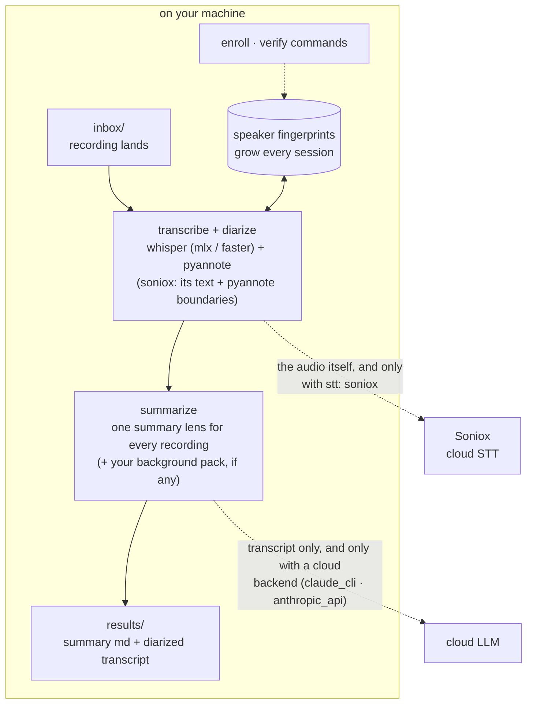

# moim-scribe

**A local-first voice pipeline built for recurring meetings — the more often the same people meet, the more accurate it gets.**

*moim* (모임) is Korean for a small recurring gathering — a book club, a writing circle, a weekly team sync. moim-scribe watches a folder, and when a recording lands in it: transcribes (whisper) → separates speakers (pyannote) → **matches voices against a fingerprint database that grows with every session** → writes a summary. It does not ask what kind of recording it is: a meeting, a call and a book club all go into the same folder and come out in the same format. Voice fingerprints are always local. Two steps are yours to choose: transcription runs on your machine by default and can instead go to Soniox, and summarization can be local (Ollama, or none) or a cloud LLM (Claude).

> **Consent first.** moim-scribe is built for groups that record themselves with everyone's informed consent. Voice fingerprints are biometric data — never use this tool to record or identify people covertly. **This bites hardest in private relationships**: a conversation with a partner or a family member is where one side is most tempted to record without saying so, and precisely where you must not. In many jurisdictions that is illegal, not just impolite: [docs/privacy.md](docs/privacy.md).

[한국어 README](README.ko.md)

## How it works



Fingerprints never cross the dashed line. Two things can, each only if you choose it: the audio (`stt: soniox`) and the transcript (a cloud summarizer). With the defaults changed to `soniox` + `none`, the recording leaves and the transcript does not; with `mlx` + `ollama`, nothing leaves at all.

## What is in the box

**Core: works as soon as it is installed.**

| | what it does |
|---|---|
| **Speaker separation** | splits the recording by who spoke when (`SPEAKER_00`, `SPEAKER_01` …) |
| **Voice fingerprints** | you confirm who is who once; from the next recording on, those people are named automatically |
| **Summary** | one summary format for every recording, with attendees, talk share, what was discussed, decisions and action items when there are any |

**Optional: off until you set it up, and the core does not depend on any of it.**

| | what it adds | where |
|---|---|---|
| Cloud transcription | Soniox instead of a local whisper model (uploads the audio) | [docs/setup-soniox.md](docs/setup-soniox.md) |
| Background packs | a recurring group's roster and running context, added to the summary prompt | [docs/packs.md](docs/packs.md) |
| Group tags | a log line when a voice match comes from a different group | "Teaching it who's who" below |
| Label verification | cross-check a finished transcript against fingerprints | [docs/speaker-verification.md](docs/speaker-verification.md) |
| Background service | launchd / systemd / Task Scheduler templates | [docs/deployment.md](docs/deployment.md) |

**Not included.** Publishing to Notion or other tools, chat notifications (Slack and the like), and phone-to-computer intake are deliberately left out. A cloud-synced folder (iCloud Drive, Google Drive, Dropbox) works as the inbox with no integration at all, and anything else can be built around `results/`, which is plain files.

## Why another whisper + pyannote script?

One-shot diarization scripts treat every recording as a room full of strangers. Recurring groups aren't: it's the same six people every other week. moim-scribe exploits that.

- **Accumulating voice fingerprints.** Confirm who's who once, and each speaker's ECAPA embedding is stored and refined (speech-seconds weighted average) every time they appear. `SPEAKER_03` becomes a real name automatically from the second session on.
- **Merge repair.** pyannote's classic failure — two similar voices fused into one cluster — is detected by re-checking segments against enrolled fingerprints, and the transcript is re-labeled. Unenrolled guests are never touched. Relabeling only applies when every anchor shows segment-level evidence of actually being in the recording; otherwise the repair is withheld and the reason is recorded (a wrong name is worse than no name).
- **Two-voice warning.** After identification, each speaker's long stretches of speech (8 seconds or more, at least five of them) are split two ways. If the smaller part holds 10% or more of the time and the two parts sound different, the log says "two voices suspected" and `speakers.json` marks the label. Labels are never changed by this; it tells you which label to listen to before enrolling it. A label with one second of sound or less that matched nobody is treated as noise: it stays in the transcript but is not counted as an attendee, and the summary is told so.
- **Anti-hallucination transcription.** Whisper's repetition loops (the same phrase 17 times at exactly 1.0s intervals) are suppressed at decode time and collapsed deterministically afterwards.
- **One summary, no sorting.** You never tell it what kind of recording this is. The summary keeps the sections that have something in them (decisions, action items, open items) and drops the rest, so a meeting reads like minutes and a catch-up reads like a catch-up. Optionally, a recurring group's roster and running context ride along in the prompt: [docs/packs.md](docs/packs.md).
- **Honest labels.** Verification tooling (`moim-scribe verify`) cross-checks finished transcripts against fingerprints and your attendee roster, following rules learned from real mislabeling incidents. See [docs/speaker-verification.md](docs/speaker-verification.md).

## Platform support

| | STT backend | status |
|---|---|---|
| macOS (Apple Silicon) | `mlx` (mlx-whisper) | tier 1 — this is the config the pipeline was built and field-tested on |
| Windows / Linux / Intel Mac | `faster` (faster-whisper) | supported by design, CI-tested at unit level — field reports welcome |
| any platform | `soniox` (cloud) | no local model, no Hugging Face token — but the audio is uploaded. See below |

pyannote and speechbrain are PyTorch and run everywhere (CUDA, MPS, CPU). The watcher uses `watchdog` (native events on all three OSes).

## Transcription backends

| backend | where it runs | speaker separation | notes |
|---|---|---|---|
| `mlx` (default on Apple Silicon) | your machine | pyannote, locally | takes a speaker count from the filename or a spoken cue |
| `faster` (default elsewhere) | your machine | pyannote, locally | same |
| `soniox` | Soniox's servers — **the audio is uploaded** | Soniox, or pyannote locally if you have a token | no model download required. Needs an API key and is billed per hour of audio |

`soniox` is fast and accurate **when people take turns speaking**; on a noisy recording where several people talked over each other, testing found it fusing distinct speakers into one. If a Hugging Face token is present, moim-scribe fixes that by keeping Soniox's text and re-deriving the speaker boundaries with pyannote locally — on by default, skipped silently without a token, and the only way a speaker count in the filename does anything on this path. Soniox alone accepts no count: diarization is a single on/off switch that detects up to 15 speakers by itself. A single file is capped at 300 minutes.

Setup and the quota you have to manage: [docs/setup-soniox.md](docs/setup-soniox.md).

## Install

Requirements: Python 3.11+, [ffmpeg](https://ffmpeg.org) on PATH (`brew install ffmpeg` / `winget install ffmpeg` / `apt install ffmpeg`).

```bash
# macOS Apple Silicon
pip install "moim-scribe[mlx] @ git+https://github.com/kemy-ai/moim-scribe"

# Windows / Linux / Intel Mac
pip install "moim-scribe[cross] @ git+https://github.com/kemy-ai/moim-scribe"
```

One-time: pyannote's diarization model is gated — create a free Hugging Face token and accept the model terms. Takes two minutes: [docs/setup-pyannote.md](docs/setup-pyannote.md).

## Quickstart

```bash
moim-scribe init ~/MyMeetings          # creates the workspace (add --language en)
# save your HF token:
echo "hf_..." > ~/MyMeetings/.hf_token

moim-scribe doctor ~/MyMeetings        # checks ffmpeg, backends, token

# drop a recording into the inbox (any kind of recording):
cp recording.m4a ~/MyMeetings/inbox/

moim-scribe watch ~/MyMeetings         # or scan-inbox for a single pass
```

Results land in `results/` as `YYMMDD_title_summary.md` plus the full diarized transcript. Want transcripts only? Set `summarizer: none`. Tips that remove guesswork:

- put the attendee count in the filename — `book club 5명.m4a` / `standup 4p.m4a`
- or say it at the start of the recording ("참석자 다섯 명입니다" / "five participants today")

## Teaching it who's who

```bash
# after the first processed session, map labels to names once.
# enroll reads the .jsonl (segment start/end live only there) and that file is
# kept in results/; the original audio lands in inbox/_done/:
moim-scribe enroll inbox/_done/rec.m4a results/YYMMDD_rec_diarized.jsonl \
    SPEAKER_00="Kim Haneul" SPEAKER_02="Lee Bada" --workspace ~/MyMeetings

# optional: say which group someone belongs to, using the pack name.
# --attends-all is for whoever is in every recording (usually you).
moim-scribe enroll … SPEAKER_00="Kim Haneul" --group book-club --workspace ~/MyMeetings
moim-scribe enroll … SPEAKER_01="Park Gureum" --attends-all --workspace ~/MyMeetings

moim-scribe speakers ~/MyMeetings      # see accumulated fingerprints and their groups

# from now on those two are auto-identified; verify a finished transcript anytime (this one reads the .txt):
moim-scribe verify inbox/_done/rec.m4a inbox/_done/rec_transcript_diarized.txt \
    --expected "Kim Haneul,Lee Bada,Park Gureum" --workspace ~/MyMeetings
```

Only enroll ranges a human has confirmed — the discipline that keeps the database trustworthy is in [docs/speaker-verification.md](docs/speaker-verification.md).

`enroll` refuses two things, because a wrong enrollment does not fail, it makes every later recording slightly more wrong:

- **One name on two labels of the same recording.** Usually a label number copied from a different run. If one person really was split into two labels, add `--allow-duplicate`.
- **A voice that scores below 0.5 against that person's existing fingerprint.** Add `--force` after listening. 0.5 is not a safety line: the same person can score lower on phone audio or against a thin fingerprint.

The others in the same command are still enrolled, and the command exits with status 1 when anything was refused.

If a name repeats ("book club.m4a" every week), nothing is overwritten: the second one is kept as `book club (2).m4a` in `inbox/_done/`, and its results as `YYMMDD_book club (2)_…` when both land on the same day. Use the name the log printed when you run `enroll` or `verify`.

**Group tags are a hint, not a rule.** A fingerprint is compared against everyone enrolled, so as the database grows a name from another recurring group can win a match. When that happens the run logs a line naming who and from where — and changes nothing else. Blocking on it was measured and rejected: people do join a second group or visit as guests, the score ranges overlap, and a tag nobody remembered to update would silently turn a correct match into an unknown. Untagged speakers, unmatched recordings, and anyone marked `--attends-all` are skipped.

## Summarizer backends

| backend | needs | transcript leaves your machine? |
|---|---|---|
| `claude_cli` (default) | Claude Code installed | yes — sent to Anthropic via your existing login |
| `anthropic_api` | `ANTHROPIC_API_KEY` | yes — sent to Anthropic's Messages API |
| `ollama` | Ollama running locally | no — nothing leaves at this step |
| `none` | nothing | no — stops at the diarized transcript |

Switch in `config.yaml`. The summary template ships in Korean and English (`--language`) and lives in your workspace at `packs/lenses/summary.<language>.md`; edit it to change what every summary looks like. This table is about the transcript only — whether the *audio* leaves is the separate `stt` choice above.

## Privacy and consent — read this

Voice fingerprints are **biometric personal data**, and recordings capture private conversation.

- **Record and enroll only with every participant's consent.** In many jurisdictions this is a legal requirement, not a courtesy — e.g. under Korea's Personal Information Protection Act, voiceprints used to identify a person are sensitive biometric information requiring separate explicit consent.
- Fingerprinting is always local, and after the first model download that step is forced offline. Two steps can reach the network, and only if you configure them to: `stt: soniox` uploads the **audio**, and a cloud summarizer sends the **transcript**. The defaults keep the audio home.
- The workspace keeps fingerprints (`speakers/`), recordings, and rosters outside the repo, and `init` drops a defensive `.gitignore` in the workspace. Never publish a workspace.

Details: [docs/privacy.md](docs/privacy.md).

## Running it in the background

launchd (macOS), systemd (Linux), and Task Scheduler (Windows) templates: [docs/deployment.md](docs/deployment.md). Cloud-synced folders (iCloud Drive, Google Drive, Dropbox) work as the inbox: before touching a file the pipeline checks that it decodes and, on macOS, that it is physically on disk or reads back whole. A file that is still downloading reports its final size and plays from the start, so size and a decode probe alone let a partly downloaded recording through.

## Maintenance

Best-effort: issues and PRs are read, response time is not guaranteed. Forks welcome.

## Upgrading from 0.1

0.2 removes recording types. What that means for an existing workspace:

- **Folders.** Recordings no longer have to be sorted into `inbox/meeting/`, `inbox/gathering/` or `inbox/transcript/`. Those folders keep working (direct subfolders of `inbox/` are still scanned), but they no longer change anything.
- **`types:` in `config.yaml`** no longer selects a lens, and a log line says so. One part of it is still honored: a folder it mapped to `null` (by default `inbox/transcript/`) stays transcript-only for as long as the block is there, so an upgrade never starts sending those transcripts to a summarizer. For transcripts only everywhere, set `summarizer: none`.
- **Lenses.** `meeting`, `gathering` and `conversation` are gone, along with `packs/styles/`. Nothing needs to be done: a workspace with no `packs/lenses/summary.<language>.md` uses the built-in one. To customize it, copy the file from the package's `templates/lenses/` into `packs/lenses/` and edit it. Old lens files left in `packs/lenses/` are harmless and unused.
- **Packs.** `"type"` and `"style"` in `match.json` are ignored; the title keyword alone decides.
- **File names.** Summaries are now `YYMMDD_title_summary.md`.
- **`moim-scribe process`** no longer needs `--type` (it is accepted and ignored).

## Roadmap (not in v0.2)

- Publishing plugins (Notion etc.) and completion notifications
- English field-testing of the `faster` backend at tier-1 level

## License

[MIT](LICENSE). Depends on openly licensed projects (whisper implementations MIT, pyannote.audio MIT, speechbrain and watchdog Apache-2.0); the gated pyannote **model weights** have their own access terms you accept on Hugging Face — they are downloaded to your machine, never redistributed here.
