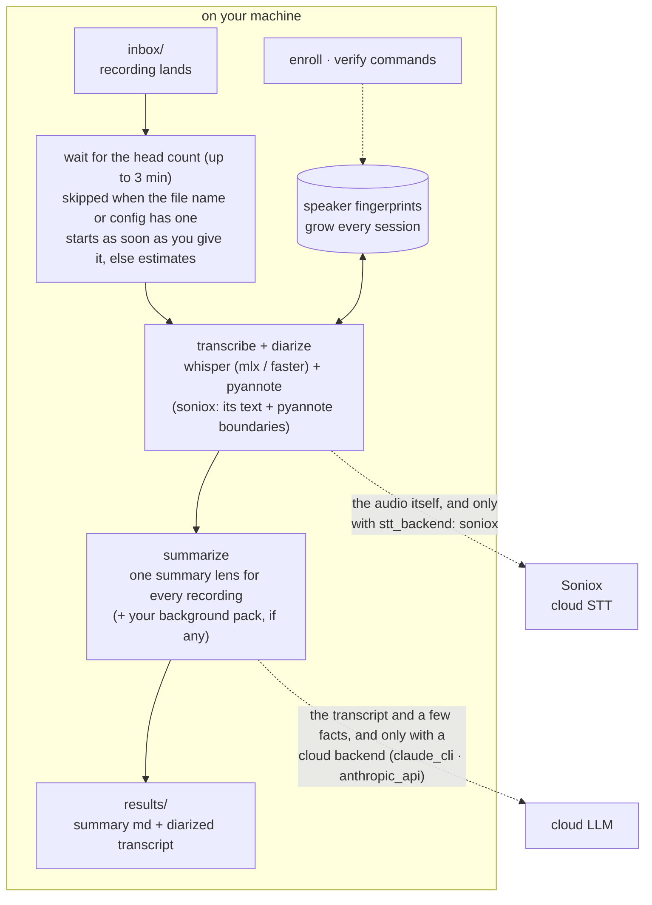

# moim-scribe

**A local-first voice pipeline built for recurring meetings — the more often the same people meet, the more accurate it gets.**

By default the summary step sends the transcript to Anthropic through Claude Code. Set `summarizer: ollama` or `summarizer: none` and the pipeline sends nothing off your machine (opening Claude Code in the workspace folder is a separate matter: see "Privacy and consent").

*moim* (모임) is Korean for a small recurring gathering — a book club, a writing circle, a weekly team sync. moim-scribe watches a folder, and when a recording lands in it: transcribes (whisper) → separates speakers (pyannote) → **matches voices against a fingerprint database that grows with every session** → writes a summary. It does not ask what kind of recording it is: a meeting, a call and a book club all go into the same folder and come out in the same format. Voice fingerprints are always local. Two steps are yours to choose: transcription runs on your machine by default and can instead go to Soniox, and summarization can be local (Ollama, or none) or a cloud LLM (Claude).

> **Consent first.** moim-scribe is built for groups that record themselves with everyone's informed consent. Voice fingerprints are biometric data — never use this tool to record or identify people covertly. **This bites hardest in private relationships**: a conversation with a partner or a family member is where one side is most tempted to record without saying so, and precisely where you must not. In many jurisdictions that is illegal, not just impolite: [docs/privacy.md](docs/privacy.md).

[한국어 README](README.ko.md)

## How it works



The pipeline never sends fingerprints across the dashed line. Two things can, each only if you choose it: the audio (`stt_backend: soniox`) and the transcript (a cloud summarizer). What the summarizer receives is the transcript, the recording's title and time, the speaker statistics, and your pack background when a pack matches; never the audio and never a fingerprint. With the defaults changed to `soniox` + `none`, the recording leaves and the transcript does not; with `mlx` + `ollama`, the pipeline sends nothing out.

## What is in the box

**Core: works as soon as it is installed.**

| | what it does |
|---|---|
| **Speaker separation** | splits the recording by who spoke when (`SPEAKER_00`, `SPEAKER_01` …) |
| **Voice fingerprints** | you confirm who is who once; from the next recording on, those people are named automatically wherever the match is confident (see "What to expect") |
| **Summary** | one summary format for every recording, with attendees, talk share, what was discussed, decisions and action items when there are any. Needs a summarizer: Claude Code by default (sends the transcript to Anthropic), or Ollama (local), or `none` (diarized transcripts only, no summary) |

**Optional: off until you set it up, and the core does not depend on any of it.**

| | what it adds | where |
|---|---|---|
| Cloud transcription | Soniox instead of a local whisper model (uploads the audio) | [docs/setup-soniox.md](docs/setup-soniox.md) |
| Background packs | a recurring group's roster and running context, added to the summary prompt | [docs/packs.md](docs/packs.md) |
| Group tags | a log line when a voice match comes from a different group | "Teaching it who is who" below |
| Label verification | cross-check a finished transcript against fingerprints | [docs/speaker-verification.md](docs/speaker-verification.md) |
| Background service | launchd / systemd / Task Scheduler templates | [docs/deployment.md](docs/deployment.md) |
| Slack notice | a message when a recording is waiting for its speaker count (you build it; no connection is built in) | [docs/notify-slack.md](docs/notify-slack.md) |

**Not included.** Publishing to Notion or other tools, a built-in chat connection, and phone-to-computer intake are deliberately left out (an optional guide shows how to attach Slack yourself). A cloud-synced folder (iCloud Drive, Google Drive, Dropbox) works as the inbox with no integration at all, and anything else can be built around `results/`, which is plain files.

## What to expect

Measured before the 0.2 release on real Korean recordings of the same three people (similar voices), against labels a person had checked. These are single recordings, not a benchmark: they show the range, not an average.

| recording | speaker count | result |
|---|---|---|
| 67 minutes, count in the file name | 3 labels for 3 people | 98.7% of the speech carried the same speaker as the checked labels |
| 4-minute excerpt, count in the file name (Windows, CPU) | 3 labels for 3 people | 97.0% |
| another day, 27 minutes, no count given | **7 labels for 3 people** | after enrolling from the first recording: 56.8% of the speech got the right name, 1.9% a wrong name, 41.3% stayed `SPEAKER_NN` |
| the same 27 minutes, count in the file name | 3 labels, two of them mixing people | 47.9% right name, 1.5% wrong name, 50.6% stayed `SPEAKER_NN` |

What that means in practice:

- **Give the number of people**, in the file name or within 3 minutes of dropping the recording in ("Telling it how many people were there" below). Without it the count is estimated, and estimation often splits one person into several labels. The run says so in a warning, and the summary then reports "N speaker labels (estimated)" instead of an attendee count.
- **A name is attached only when the match is confident.** The tool would rather leave `SPEAKER_NN` than guess: across these runs a wrong name landed on under 2% of the speech. Expect unnamed stretches, especially with similar voices, and check the transcript before trusting who said what.
- **Recordings differ.** The same three people gave 98.7% on one day and about half on another. Voices that sound alike get merged or split by the diarization model itself; fingerprints cannot repair that after the fact, and enrolling from more than one recording helps the matching, not the splitting.
- **Speed.** On an Apple Silicon Mac the 67-minute recording took 17 minutes (peak memory 1.1 GB). On a laptop CPU without a GPU, expect about 1.5 to 2.5 times the length of the recording.

## Why another whisper + pyannote script?

One-shot diarization scripts treat every recording as a room full of strangers. Recurring groups aren't: it's the same six people every other week. moim-scribe exploits that.

- **Accumulating voice fingerprints.** Confirm who's who once, and each speaker's ECAPA embedding is stored and refined (speech-seconds weighted average) every time they appear. From the next session on, `SPEAKER_03` becomes a real name wherever the match is confident (how often that is: "What to expect").
- **Merge repair.** pyannote's classic failure — two similar voices fused into one cluster — is detected by re-checking segments against enrolled fingerprints, and the transcript is re-labeled. Unenrolled guests are never touched. Relabeling only applies when every anchor shows segment-level evidence of actually being in the recording; otherwise the repair is withheld and the reason is recorded (a wrong name is worse than no name).
- **Two-voice warning.** After identification, each speaker's long stretches of speech (8 seconds or more, at least five of them) are split two ways. If the smaller part holds 10% or more of the time and the two parts sound different, the log says "two voices suspected" and `speakers.json` marks the label. Labels are never changed by this; it tells you which label to listen to before enrolling it. A label with one second of sound or less that matched nobody is treated as noise: it stays in the transcript but is not counted as an attendee, and the summary is told so.
- **Anti-hallucination transcription.** Whisper's repetition loops (the same phrase 17 times at exactly 1.0s intervals) are suppressed at decode time and collapsed deterministically afterwards.
- **One summary, no sorting.** You never tell it what kind of recording this is. The summary keeps the sections that have something in them (decisions, action items, open items) and drops the rest, so a meeting reads like minutes and a catch-up reads like a catch-up. Optionally, a recurring group's roster and running context ride along in the prompt: [docs/packs.md](docs/packs.md).
- **Honest labels.** Verification tooling (`moim-scribe verify`) cross-checks finished transcripts against fingerprints and your attendee roster, following rules learned from real mislabeling incidents. See [docs/speaker-verification.md](docs/speaker-verification.md).

## Platform support

| | STT backend | status |
|---|---|---|
| macOS (Apple Silicon) | `mlx` (mlx-whisper) | tier 1 — this is the config the pipeline was built and field-tested on |
| Windows / Linux | `faster` (faster-whisper) | supported by design, CI-tested at unit level; field reports welcome |
| macOS (Intel) | none | not supported: pyannote.audio 4 needs PyTorch 2.8 or newer, and PyTorch publishes no macOS Intel builds after 2.2.2, so the install cannot resolve |
| any supported platform | `soniox` (cloud) | no local model, no Hugging Face token — but the audio is uploaded. See below |

pyannote and speechbrain are PyTorch and run everywhere (CUDA, MPS, CPU). The watcher uses `watchdog` (native events on all three OSes).

## Transcription backends

| backend | where it runs | speaker separation | notes |
|---|---|---|---|
| `mlx` (default on Apple Silicon) | your machine | pyannote, locally | takes a speaker count from the filename, from you, or from a spoken cue |
| `faster` (default elsewhere) | your machine | pyannote, locally | same |
| `soniox` | Soniox's servers — **the audio is uploaded** | Soniox, or pyannote locally if you have a token | no model download required. Needs an API key and is billed per hour of audio |

`soniox` is fast and accurate **when people take turns speaking**; on a noisy recording where several people talked over each other, testing found it fusing distinct speakers into one. If a Hugging Face token is present, moim-scribe fixes that by keeping Soniox's text and re-deriving the speaker boundaries with pyannote locally — on by default, skipped silently without a token, and the only way a speaker count (from the filename, or one you give) changes the speaker separation on this path. Soniox alone accepts no count: diarization is a single on/off switch that detects up to 15 speakers by itself. Without the hybrid step, a count you give is not used for separation and only goes into the summary's attendee line. A single file is capped at 300 minutes.

Setup and the quota you have to manage: [docs/setup-soniox.md](docs/setup-soniox.md).

## Install

You need Python 3.11 or newer (clean installs were run on 3.12 and 3.14; CI runs 3.11 to 3.13), `git`, and [ffmpeg](https://ffmpeg.org) (it provides `ffmpeg` and `ffprobe`). Each block below starts from nothing: it creates a virtual environment first, so the `moim-scribe` command exists only while that environment is active (activate it again in every new terminal). Use `[mlx]` on an Apple Silicon Mac and `[cross]` on Windows and Linux. Intel Macs are not supported (see "Platform support").

**What to expect.** Installing takes a couple of minutes and about 1.6 GB of disk for the virtual environment (measured on Apple Silicon with Python 3.12: 134 s). The first recording downloads about 1.6 GB of models once (measured: about 3 minutes), and the first `enroll` downloads the speaker model (about 170 MB). The first `doctor` can sit silent for up to a minute while it imports the heavy packages.

**macOS, Apple Silicon**

```bash
brew install git ffmpeg
python3 -m venv ~/moim-scribe-env
source ~/moim-scribe-env/bin/activate
pip install "moim-scribe[mlx] @ git+https://github.com/kemy-ai/moim-scribe@v0.2.1"
moim-scribe --version
```

**Windows (PowerShell)**

```powershell
winget install Git.Git
winget install Gyan.FFmpeg
py -m venv $HOME\moim-scribe-env
& $HOME\moim-scribe-env\Scripts\Activate.ps1
pip install "moim-scribe[cross] @ git+https://github.com/kemy-ai/moim-scribe@v0.2.1"
moim-scribe --version
```

Open a new PowerShell window after the winget installs so `git` and `ffmpeg` are on PATH.

If activation fails with "running scripts is disabled on this system", Windows is blocking scripts (the default). Either allow them for the current window only with `Set-ExecutionPolicy -Scope Process -ExecutionPolicy RemoteSigned` and activate again, or skip activation and call the tools by path, for example `& $HOME\moim-scribe-env\Scripts\pip.exe install ...` and `& $HOME\moim-scribe-env\Scripts\moim-scribe.exe --version`.

**Linux (Debian / Ubuntu shown; use your package manager)**

```bash
sudo apt install git ffmpeg python3-venv
python3 -m venv ~/moim-scribe-env
source ~/moim-scribe-env/bin/activate
pip install "moim-scribe[cross] @ git+https://github.com/kemy-ai/moim-scribe@v0.2.1"
moim-scribe --version
```

One-time: pyannote's diarization model is gated, so you need a free Hugging Face token and you must accept the terms of three model pages. It takes a few minutes: [docs/setup-pyannote.md](docs/setup-pyannote.md). Not needed with `stt_backend: soniox`.

## Quickstart

With the virtual environment active:

```bash
moim-scribe init ~/MyMeetings --language en   # creates the workspace (default language: ko)
cd ~/MyMeetings
```

Save your Hugging Face token into the workspace, then check the setup. macOS / Linux:

```bash
echo "hf_..." > .hf_token
```

Windows PowerShell (`echo ... >` writes UTF-16 there; this does not):

```powershell
Set-Content -Path .hf_token -Value "hf_..." -Encoding ascii
```

```bash
moim-scribe doctor --online
```

`doctor` checks ffmpeg, the backend packages and the token, and prints where your audio and your transcript will go. With `--online` it also asks Hugging Face whether your token can open each of the three gated model pages, and names the page that still needs "Agree and access repository". Without `--online` it never touches the network.

Then drop a recording into the inbox (any kind of recording) and start the watcher:

```bash
cp recording.m4a inbox/
moim-scribe watch
```

A recording without a head count in its name waits up to 3 minutes for one (next section). Use `moim-scribe scan-inbox` instead of `watch` for a single pass; it waits in place, and `--no-wait` skips the wait. Commands take the workspace folder as an argument, or use the current folder when you run them inside it. Every command except `init` refuses a folder that has no `config.yaml`.

Results land in `results/` as `YYMMDD_title_summary.md` plus the full diarized transcript. Want transcripts only? Set `summarizer: none`. Tips that remove guesswork:

- put the attendee count at the end of a word in the filename: `book club 5명.m4a` (language `ko`) or `standup 4p.m4a` (other languages)
- or say it at the start of the recording ("참석자 다섯 명입니다" / "five participants today")
- or give it after you drop the recording in (next section)

The filename count is recognized only in these forms: with `language: ko`, a number of one or two digits followed by `명` or `인` (`5명`, `3인`) that is not followed by another Korean syllable; with any other language, a number followed by `p`, `ppl`, `people` or `speakers` as a whole word (`4p`, `4 people`, `4 speakers`). Only 1 to 30 counts. A date such as `1103`, a year, or a word such as `3인칭` or `인터뷰` is not read as a count, and a title that holds no count is left untouched.

If setup is incomplete (no token, no ffmpeg, a missing backend package, no summarizer tool), `watch`, `scan-inbox` and `process` say what is missing and leave every recording where it is; nothing is claimed or moved until the setup is complete. `scan-inbox` exits with status 1 on a setup problem or when a recording failed.

## Telling it how many people were there

The number of people is the biggest help to speaker separation (see "What to expect"), so moim-scribe gives you a moment to say it before it starts.

1. Put the recording in `inbox/`. If its file name already holds the count (`... 5명` / `... 5p`), or `default_speakers` in `config.yaml` is not 0, it starts at once, as before.
2. If not, the recording stays where it is and waits up to **3 minutes**.
3. In that time, give the count in one of two ways:
   - Tell Claude, with Claude Code open in the workspace folder: "the one I just added had 4 people". `init` puts a `CLAUDE.md` in the workspace that tells Claude what to do.
   - Or run `moim-scribe count 4` yourself. If one recording is waiting, that is the one. If two or more are waiting, add part of a file name: `moim-scribe count 4 "team sync"`.
4. Once you give it, the recording starts within a few seconds. If you do not, it starts after the 3 minutes with an estimated count, and the summary says the count is estimated. A count from the file name, from you, from the start of the recording or from `default_speakers` is written as fixed; only a guess is marked as estimated.

```
$ moim-scribe waiting
team-sync.m4a	3:00 left
$ moim-scribe count 4
recorded 4 speakers for team-sync.m4a
it is processed on the next inbox pass
```

"The next inbox pass" is the next check of the inbox. While a recording waits, `watch` and `scan-inbox` check about every 2 seconds, so the start follows within a few seconds.

- `moim-scribe waiting` lists what is waiting, one line each: the file name, a tab, and the time left (`3:00 left`). `not scanned yet` instead of a time means the inbox check has not reached that file yet; its wait starts when it does. It prints nothing when nothing waits.
- **Two or more recordings waiting.** A `count` without a name is then not recorded (it exits with status 1): it shows the list and asks you to name the one it is for, `moim-scribe count 4 <part of its name>`. With none waiting it says so. A file that is still being copied, or is damaged, counts as waiting too, so while one is in `inbox/` you need to name the recording.
- The name can be a part of the file name or a path: `moim-scribe count 4 inbox/team-sync.m4a`. A path outside `inbox/` is refused.
- **To correct a count, name the recording:** `moim-scribe count 4 <part of its name>`. Without a name, if the first recording has already started transcribing and left `inbox/`, the count can be recorded for another recording that has arrived in the meantime.
- If the file name already has a count, the file name wins over the one you give.
- **Renaming or moving a waiting recording starts it over.** moim-scribe sees a renamed file, or one moved into a subfolder, as a new recording: its wait begins again and a count you already gave is gone. Give the count after you have settled the name.
- `watch` and `scan-inbox` both start a recording within a few seconds of the count arriving. `scan-inbox` waits in place, up to 3 minutes, and says so on screen; `--no-wait` makes it process at once instead. Ctrl-C while it waits puts everything back in `inbox/` (exit status 130). If a `watch` is already processing `inbox/`, `scan-inbox` stops and leaves the recordings to it.
- The wait is `speaker_count_wait_sec` in `config.yaml`: 180 by default, 0 for no wait (what 0.2.0 did). If you run `scan-inbox` from cron or Task Scheduler, use `--no-wait` or 0.
- A count said aloud at the start of the recording is only known after transcription, so such a recording waits the 3 minutes too. (With `stt_backend: soniox` a spoken count and `default_speakers` are not used at all.)
- **With `stt_backend: soniox`** and no Hugging Face token, Soniox separates the speakers itself and takes no count, so the count you give does not change the separation: it only goes into the summary's attendee line (as a fixed number, not an estimate). If that line does not matter to you, set `speaker_count_wait_sec: 0` and skip the wait. See [docs/setup-soniox.md](docs/setup-soniox.md).
- To get a Slack message when a recording waits, see [docs/notify-slack.md](docs/notify-slack.md). It is optional and nothing is connected by default.

## Teaching it who is who

The examples use one recording, saved as `weekly sync 2p.m4a`. After it has been processed, find the real names with `ls results` and `ls inbox/_done`: the results carry the title without the count hint (`results/YYMMDD_weekly sync_diarized.jsonl`, `..._transcript.txt`, `..._summary.md`), while the original files in `inbox/_done/` keep the full name (`weekly sync 2p.m4a`, `weekly sync 2p_transcript_diarized.txt`, `weekly sync 2p_speakers.json`). Names with spaces need quotes. Run these from the workspace folder:

```bash
# after the first processed session, map labels to names once.
# enroll reads the .jsonl (segment start/end live only there), kept in results/;
# the original audio is in inbox/_done/. Replace YYMMDD with the date in the file name:
moim-scribe enroll "inbox/_done/weekly sync 2p.m4a" "results/YYMMDD_weekly sync_diarized.jsonl" SPEAKER_00="Kim Haneul" SPEAKER_02="Lee Bada"

# optional: say which group someone belongs to, using the pack name.
# --attends-all is for whoever is in every recording (usually you).
moim-scribe enroll "inbox/_done/weekly sync 2p.m4a" "results/YYMMDD_weekly sync_diarized.jsonl" SPEAKER_00="Kim Haneul" --group book-club
moim-scribe enroll "inbox/_done/weekly sync 2p.m4a" "results/YYMMDD_weekly sync_diarized.jsonl" SPEAKER_01="Park Gureum" --attends-all

moim-scribe speakers      # see accumulated fingerprints and their groups

# from the next recording on those people are named where the match is confident; verify a finished transcript anytime (this one reads the .txt):
moim-scribe verify "inbox/_done/weekly sync 2p.m4a" "inbox/_done/weekly sync 2p_transcript_diarized.txt" --expected "Kim Haneul,Lee Bada,Park Gureum"
```

Verifying the very recording you enrolled from still shows `SPEAKER_NN` labels: enrollment does not rewrite that transcript, and names appear from the next recording on, where the match is confident.

Only enroll ranges a human has confirmed — the discipline that keeps the database trustworthy is in [docs/speaker-verification.md](docs/speaker-verification.md).

`enroll` refuses two things, because a wrong enrollment does not fail, it makes every later recording slightly more wrong:

- **One name on two labels of the same recording.** Usually a label number copied from a different run. If one person really was split into two labels, add `--allow-duplicate`.
- **A voice that scores below 0.5 against that person's existing fingerprint.** Add `--force` after listening. 0.5 is not a safety line: the same person can score lower on phone audio or against a thin fingerprint.

A label that is not in the jsonl is refused too. The others in the same command are still enrolled, and the command exits with status 1 when anything was refused.

If a name repeats ("weekly sync.m4a" every week), nothing is overwritten: the second one is kept as `weekly sync (2).m4a` in `inbox/_done/`, and its results as `YYMMDD_weekly sync (2)_…` when both land on the same day. Use the name the log printed, or `ls`, when you run `enroll` or `verify`.

**Group tags are a hint, not a rule.** A fingerprint is compared against everyone enrolled, so as the database grows a name from another recurring group can win a match. When that happens the run logs a line naming who and from where — and changes nothing else. Blocking on it was measured and rejected: people do join a second group or visit as guests, the score ranges overlap, and a tag nobody remembered to update would silently turn a correct match into an unknown. Untagged speakers, unmatched recordings, and anyone marked `--attends-all` are skipped.

## Summarizer backends

| backend | needs | transcript leaves your machine? |
|---|---|---|
| `claude_cli` (default) | Claude Code installed | yes — sent to Anthropic via your existing login |
| `anthropic_api` | `ANTHROPIC_API_KEY` | yes — sent to Anthropic's Messages API |
| `ollama` | Ollama running locally | no — nothing leaves at this step |
| `none` | nothing | no — stops at the diarized transcript |

With `claude_cli`, the CLI is started with no tools, no MCP servers, neither your global instructions nor your user settings, and no session kept on disk (the prompt is not saved in Claude Code's session history), and it runs from an empty temporary directory: the transcript is only ever read as text, and the summary does not depend on how that machine's Claude Code is set up. The summary is written in the language of the transcript. A Claude Code version too old for these flags is refused with a message to update it or choose another summarizer; it is not retried without them.

Switch in `config.yaml`. The summary template ships in Korean and English (`--language`) and lives in your workspace at `packs/lenses/summary.<language>.md`; edit it to change what every summary looks like. This table is about the transcript only — whether the *audio* leaves is the separate `stt_backend` choice above.

## Privacy and consent — read this

Voice fingerprints are **biometric personal data**, and recordings capture private conversation.

- **Record and enroll only with every participant's consent.** In many jurisdictions this is a legal requirement, not a courtesy — e.g. under Korea's Personal Information Protection Act, voiceprints used to identify a person are sensitive biometric information requiring separate explicit consent.
- Fingerprinting is always local, and after the first model download that step is forced offline. Two steps can reach the network, and only if you configure them to: `stt_backend: soniox` uploads the **audio** (and `glossary.txt` as context, if you keep one), and a cloud summarizer sends the **transcript** (with the recording title and time, speaker statistics, and your pack background when a pack matches). The defaults keep the audio home.
- The workspace keeps fingerprints (`speakers/`), recordings, and rosters outside the repo, plus a small record of head counts you gave (`.moim-scribe-headcount/`, see [docs/privacy.md](docs/privacy.md)), and `init` drops a defensive `.gitignore` in the workspace (it also covers `packs/` and `glossary.txt`). Never publish a workspace.
- **Opening Claude Code in the workspace is a new boundary.** If you open Claude Code in the workspace folder (for example to tell Claude a head count), Claude can read every file there: recordings, transcripts, summaries and fingerprints. What it reads is sent to Anthropic as part of that conversation. The `CLAUDE.md` that `init` writes tells Claude not to open them unless you ask, but that is an instruction, not a lock: nothing blocks it. If that is not acceptable, open Claude Code in another folder and give counts with `moim-scribe count`.
- **A Slack notification, if you set one up, sends recording file names to Slack.** It is off unless you build it ([docs/notify-slack.md](docs/notify-slack.md)); file names are often meeting titles or people's names.

Details: [docs/privacy.md](docs/privacy.md).

## Running it in the background

launchd (macOS), systemd (Linux), and Task Scheduler (Windows) templates: [docs/deployment.md](docs/deployment.md). Cloud-synced folders (iCloud Drive, Google Drive, Dropbox) work as the inbox: before touching a file the pipeline checks that it decodes and, on macOS, that it is physically on disk or reads back whole. A file that is still downloading reports its final size and plays from the start, so size and a decode probe alone let a partly downloaded recording through.

## When something goes wrong

- **Setup problems stop before touching your recordings.** No token, no ffmpeg, a missing backend package or a missing summarizer tool: `watch` / `scan-inbox` / `process` print what is missing and leave every recording in the inbox. Fix it and the next pass picks them up. `watch` keeps running and checks again each pass.
- **`inbox/_error/`** holds a recording that failed on its own (it could not be decoded, the filename was too long, a leftover from a run that stopped halfway). Read the log line for the reason, fix it, and move the file back into `inbox/` to retry.
- **A failed summary does not lose the transcript.** The diarized transcript is written to `results/` before the summary is attempted, so you keep it even when the summarizer failed. Move the recording back to `inbox/` to try the summary again.
- **A recording that sits in `inbox/` for a few minutes with no warning** may be waiting for its speaker count, not stuck: `moim-scribe waiting` lists it, and it starts by itself once the wait (3 minutes by default) is over.
- **A file that stays in `inbox/` and logs a warning** is either still downloading or not a valid audio file. If it is not downloading, remove it from `inbox/`.
- `scan-inbox` exits with status 1 when a recording failed or the setup is incomplete, so a scheduler can notice.

## Maintenance

Best-effort: issues and PRs are read, response time is not guaranteed. Forks welcome.

## Upgrading from 0.2.0

A recording with no count in its file name now waits up to 3 minutes before it starts (see "Telling it how many people were there"). To get 0.2.0 behaviour back, set `speaker_count_wait_sec: 0` in `config.yaml`. Run `moim-scribe init <workspace>` again to add the `CLAUDE.md` guide file; an existing one is left alone.

## Upgrading from 0.1

0.2 removes recording types, but an upgrade changes nothing about which files are processed or summarized until you opt in:

- **If `config.yaml` still has a `types:` block**, exactly the subfolders it names are scanned, as in 0.1: not `inbox/` itself and not other subfolders. Folder names are compared ignoring case and Unicode form (`Private` matches `private`). A folder mapped to `null` (by default `inbox/transcript/`) stays transcript-only, so those transcripts never start going to a summarizer. The block no longer selects a lens, and a log line says so. A `types:` line with nothing after it meant 0.1's built-in map and is still read that way: the folders `meeting`, `gathering` and `transcript` are scanned, and `transcript` is transcript-only. If recordings sit in `inbox/` itself or in other subfolders while the block is there, every pass logs one warning with their count and the remedy: delete the `types:` block from `config.yaml` to use the flat inbox. For transcripts only everywhere, set `summarizer: none`.
- **Without a `types:` block** (a new 0.2 workspace, or after you delete it), `inbox/` and its direct subfolders are scanned, and recordings are processed the same wherever they sit.
- **Lenses.** `meeting`, `gathering` and `conversation` are gone, along with `packs/styles/`. Run `moim-scribe init <workspace>` again: it adds the missing lens files and never touches `config.yaml`. A workspace with no `packs/lenses/summary.<language>.md` uses the built-in one meanwhile. Old lens files left in `packs/lenses/` are harmless and unused.
- **Packs.** `"type"` and `"style"` in `match.json` are ignored; the title keyword alone decides.
- **File names.** Summaries are now `YYMMDD_title_summary.md`.
- **`moim-scribe process`** no longer needs `--type` (it is accepted and ignored). It works on a private copy and refuses a file that is inside the workspace `inbox/`.
- **`init` is safe to run again.** It never overwrites `config.yaml`, it adds missing lens files, the `CLAUDE.md` guide file and `.gitignore` entries, and `--force` is now a no-op. `--reset-config` writes a fresh config after saving the old one as `config.yaml.bak`; an existing backup is never overwritten (the next ones are `config.yaml.bak.2`, `config.yaml.bak.3`, ...), and the command prints the name it used. The fresh config gets the language given with `--language` (default `ko`), and the command says which one it wrote.
- **`config.yaml` is validated when loaded.** An unknown key is reported, a wrong value is an error before anything is transcribed, `summarizer: null` means `none`, and `stt` is accepted as another spelling of `stt_backend`.

## Roadmap (not in v0.2)

- Publishing plugins (Notion etc.) and completion notifications
- English field-testing of the `faster` backend at tier-1 level

## License

[MIT](LICENSE). Depends on openly licensed projects (whisper implementations MIT, pyannote.audio MIT, speechbrain and watchdog Apache-2.0); the gated pyannote **model weights** have their own access terms you accept on Hugging Face — they are downloaded to your machine, never redistributed here.
